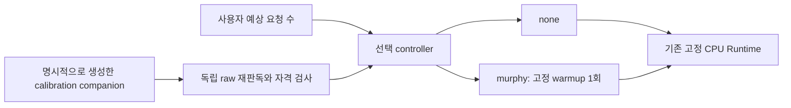

# Murphy 0.2 경제성 선택

상태: **PARTIAL / 고정 CPU calibration·choice 재판독과 선택된 none 실행 관측 완료, Windows 회귀 631 PASS**.
검토일 2026-10-15. 이 문서는 기존 [Runtime/Murphy 0.1](RUNTIME_MURPHY.md)의 고정 CPU
실행 경로 앞에서 준비 방식을 고르는 별도 계약이다. 0.1 raw evidence·source 26개·
[공개 집계](benchmarks/2026-10-15-runtime-murphy-summary.json)는 변경하지 않는다.
그 결과와 과거 CI는 새 controller의 검증 결과가 아니다.
새 검증은 별도 [0.2 공개 집계](benchmarks/2026-10-15-murphy-selection-summary.json)에 기록한다.
실제 auto 선택은 모두 `none`이었고, live auto Murphy 양성 실행은 검증하지 않았다.

## 선택하는 것

Murphy 0.2는 세션을 시작하기 전에 `none` 또는 `murphy`를 선택한다. `none`은 추가
warmup 없이 준비하고, `murphy`는 0.1의 고정 1-token warmup을 수행한 뒤 context와
sampler를 폐기한다. 실행 중 mode를 바꾸거나 요청 수에 따라 다시 선택하지 않는다.
모델 handle과 요청별 fresh context/sampler 수명, CPU thread 4·context 512·batch 128·
최대 output 64 token, cache 0은 기존 고정 프로파일을 유지한다.

선택 기준은 사용자가 선언한 **예상 요청 수**와 같은 실행 조건의 calibration 비용이다.
예상 요청 수는 workload 예측, 실제 요청 quota, 예약 자원이나 세션 자동 종료 조건이
아니다. 두 고정 입력에서 측정한 평균을 미래 N개 요청에 적용하는 좁은 추정이다.
품질 향상·latency 보장·OS resource reservation을 뜻하지 않는다.

## 구현과 책임

| 구현 | 책임 | 경계 |
|---|---|---|
| [순수 policy](../hosted/experimental/cellivane_murphy_policy/policy.py) | `choose()`의 round별 비용 비교, `baseline()`의 명시적 fallback record | 파일·network·process I/O 없음. 전달받은 calibration을 인증하지 않으며 caller가 먼저 자격을 검사 |
| [새 CLI](../tools/hosted/cellivane_murphy_lab.py) | `calibrate`, `plan`, `smoke`, `serve`; 현재 artifact/source/host 확인 후 선택을 고정 | 원문·source snapshot을 local root에 저장. Calibration을 자동 생성하지 않음 |
| [독립 reader](../tools/hosted/verify_cellivane_murphy.py) | companion·raw evidence·identity·host·age·output 연결과 비용식을 별도 재계산 | policy/launcher/Runtime 구현을 import하지 않음. Live tensor 실행·host attestation과 구분 |
| [기존 0.1 reader](../tools/hosted/verify_cellivane_runtime.py) | 네 phase raw protocol·native generation·cleanup 재판독 | 동결한 0.1 계약 유지. 새 reader가 이 재판독에 추가 qualification을 연결 |



새 policy package는 기존 runtime source glob 밖에 있다. Runtime closure **26개**와
controller/reader closure **8개**를 각각 snapshot·hash로 연결한다. Controller 8개는
policy package의 `__init__.py`·`policy.py`, 새 launcher·새 reader, 기존 runtime·
speculation·comparison·bridge reader다. 수가 같다는 이유로 다른 file hash를 수용하지
않는다. 실제 source 목록은 launcher의 `CONTROLLER_PATHS`와 reader의 동명 집합이 정한다.

## Calibration 자격

Calibration은 사용자가 `--mode calibrate`로 따로 요청하는 실제 모델 실행이다.
기존 고정 `none,murphy,murphy,none` 네 phase·실제 요청 8개·Murphy warmup 2개를 실행한다.
모델을 load하고 token을 생성하며 source/model/library를 재검사하므로 비용이 있다.
`plan`이나 `serve`가 calibration을 대신 생성하거나 비용을 숨기지 않는다.

Companion은 schema 1, artifact family `cellivane-murphy-calibration-v1`이다. 기존 raw
summary의 bytes·SHA, 동결 runtime 26개 source, 별도 controller 8개 snapshot·실행 후 hash,
calibration 전후의 host profile과 raw 재판독을 연결한다. 저장된 `PASS` 문자열을 믿는
대신 reader가 raw summary와 protocol·build·artifact·cleanup을 다시 검사한다.

Host profile은 Windows version·machine architecture·CPU name/vendor·논리 processor 수·
물리 RAM 총량을 기록하며 전후 일치를 요구한다. 사용자 이름·machine GUID·serial·PID를
물리 host 인증 수단으로 사용하지 않는다. 이 profile의 일치는 기록된 호환 조건이며,
같은 물리 장치의 인증이나 현재 host load·전력·온도·성능 보장이 아니다. 가용 RAM에
대한 실제 실행 전 admission은 기존 Runtime의 별도 fresh snapshot 검사다.

선택 시 다음 조건을 확인한다.

1. Calibration companion과 raw protocol·build·model·worker/library·source·cleanup의 유효성.
2. 현재 runtime 26개와 controller 8개 source digest, model·worker·build receipt·engine identity의 일치.
3. 현재 host profile과 calibration 전후 profile의 일치.
4. 선택 시각 기준 age가 0..86,400초, 즉 24시간 이내. 미래 시각도 범위 밖이다.
5. 각 case의 `text`, `tokens`, `prompt_tokens`, `completion_tokens`, `finish_reason`,
   `rendered_prompt_sha256`가 모든 phase에서 동일한지. 동일 답변이 정답이라는 뜻은 아니다.

유효한 0.1 raw summary에는 이 host companion이 없다. 원문 재판독을 통과해도
`legacy-no-host`로 `none`을 선택한다. 나중에 host 정보를 붙여 과거 기록을 새 calibration으로
승격하지 않는다. 새 calibration·choice·verdict는 별도 디렉터리에 저장한다.

## 비용식과 선택 record

`--expected-requests`는 정수 **1..1024**, 기본 **1**이다. 순수 policy도 bool·float·
범위 밖 입력을 거부한다. CLI 범위 오류는 실행 전에 실패하며, 예상 요청 수를 모델이
임의로 늘리거나 작은 모델·다른 장치로 바꾸지 않는다.

Round 0은 phase 0 none / phase 1 murphy, round 1은 phase 3 none / phase 2 murphy다.
각 mode·round의 준비 비용을 P, 실제 두 요청 wall time의 평균을 G라 하면:

`C(mode, round, N) = P + N × G`

P는 기존 native 실험의 worker load+prepare, G는 실제 요청 wall time이다. 이 식은
새 auto CLI의 model/library hash·source 검사·독립 calibration/choice 재판독 시간과
명시적 calibration 실험 자체의 비용을 **제외**한다. 요청 wall에는 기존 protocol·동기
증거 I/O가 포함된다. 따라서 C만으로 CLI 시작부터 종료까지의 가속을 주장하지 않는다.
Controller 전체 wall time은 아래에 별도 관측으로 기록한다.

**두 round 각각** `C(murphy) ≤ 0.95 × C(none)`이면서 `C(murphy) < C(none)`이어야
`murphy`를 선택한다. 두 round를 합친 평균으로 한 round의 손해를 숨기지 않는다.
준비 시간은 0..3600초, 각 요청 시간은 0보다 크고 3600초 이하인 유한 수치여야 한다.
유효한 calibration이라도 비용 조건을 충족하지 않으면 `none`이다.

Decision schema 1의 policy 이름은 `murphy-session-cost-v1`이다. `expected_requests`,
`margin_percent=5`, `eligible`, `selected_mode`, `reason`, 각 round의 준비·평균 요청·
추정 세션 비용과 `qualifies`를 기록한다. `eligible=true`는 유효한 비교 자료가 있다는
뜻이며 Murphy 선택·실제 성능 이익을 뜻하지 않는다. 추정 scope는
`fixed-calibration-corpus-cost-estimate`다.

| 자료·조건 | 선택 / 결과 | `reason` |
|---|---|---|
| Calibration을 제공하지 않음 | none, eligible false | `no-calibration` |
| 유효한 기존 0.1 raw만 제공 | none, eligible false | `legacy-no-host` |
| Source 또는 실행 identity 불일치 | none, eligible false | `source-mismatch` / `identity-mismatch` |
| Host profile 또는 age 불일치 | none, eligible false | `host-profile-mismatch` / `calibration-expired` |
| Case별 output 불일치 | none, eligible false | `output-mismatch` |
| 유효한 자료이지만 두 round 비용 조건 미충족 | none, eligible true | `insufficient-consistent-savings` |
| 유효한 자료와 두 round 비용 조건 충족 | murphy, eligible true | `consistent-session-savings` |
| 제공 자료의 parse·hash·schema·raw 재판독 실패 | **BLOCKED**, native 실행 시작 안 함 | 실패 원인은 별도 local blocked record |

Choice는 artifact family `cellivane-murphy-choice-v1`이며 현재 host·identity, calibration
참조와 decision을 연결한다. 독립 reader의 PASS는 이 저장 record와 산술·자격 연결을
재계산한 범위다. 선택한 mode로 live 모델이 실행됐다는 증거는 별도의 execution record다.

## 실행 방법

먼저 [Runtime build 절](RUNTIME_MURPHY.md#build와-실행)의 준비·build 블록을 같은
PowerShell에서 완료한다. 그 블록의 `$taskWorker`, `$taskReceipt`, `$taskAssets`, `$taskTiny`
변수를 사용한다. 새 저장 위치는 아래 기본값 대신 용량이 충분한 local D:를 선택해도 된다.
모든 모드는 `--worker-exe`, `--build-receipt`, `--asset-root`, `--model-file`, `--storage-root`를
필수로 받는다. 기존 고정 Qwen3-0.6B Q8_0와 sealed b11429 CPU build만 대상이다.

```powershell
$taskSelectionRoot = Join-Path $env:LOCALAPPDATA 'Cellivane/murphy-selection'
$taskMurphyArgs = @('--worker-exe',$taskWorker,'--build-receipt',$taskReceipt,'--asset-root',$taskAssets,'--model-file',$taskTiny,'--storage-root',$taskSelectionRoot)
$taskExpectedRequests = 1
$taskPlanText = py -3 -B tools/hosted/cellivane_murphy_lab.py --mode plan @taskMurphyArgs --expected-requests $taskExpectedRequests
if ($LASTEXITCODE -ne 0) { throw 'Murphy plan failed before launch' }
$taskPlanText
$taskChoice = ($taskPlanText | Select-Object -Last 1 | ConvertFrom-Json).choice
py -3 -B tools/hosted/verify_cellivane_murphy.py $taskChoice --source-root (Get-Location).Path
```

`plan`이 기본 mode다. Model/library/build/source hash와 host profile을 읽고 local choice·
verdict를 저장하지만 native child는 띄우지 않는다. 위 명령은 calibration을 제공하지
않으므로 `none`을 선택한다. 재판독에 필요한 기존 파일을 읽는 I/O와 실제 token 생성은
구분한다. Model hash 읽기는 OS page cache를 데울 수 있다.

새 calibration이 필요할 때만 다음을 **명시적으로** 실행한다. 이 명령은 실제 모델을
기동하는 네 phase 실험이며 `--calibration`을 동시에 받지 않는다.

```powershell
$taskCalibrationText = py -3 -B tools/hosted/cellivane_murphy_lab.py --mode calibrate @taskMurphyArgs
if ($LASTEXITCODE -ne 0) { throw 'Calibration did not complete' }
$taskCalibrationText
$taskCalibration = ($taskCalibrationText | Select-Object -Last 1 | ConvertFrom-Json).calibration
py -3 -B tools/hosted/cellivane_murphy_lab.py --mode plan @taskMurphyArgs --calibration $taskCalibration --expected-requests $taskExpectedRequests
```

`$taskExpectedRequests`를 바꿀 때는 실제 사용 예상에 맞는 1..1024 값을 선언한다.
유리한 결과를 얻기 위해 숫자를 올린 뒤 미래 절감이 검증됐다고 읽지 않는다. Calibration의
두 짧은 입력과 실제 세션의 prompt 길이·출력 길이·host 부하가 다를 수 있다.

선택한 mode로 실제 실행할 때는 다음 두 명령 중 목적에 맞는 하나를 선택한다.
`smoke`는 선택 mode의 한 phase·고정 실제 요청 두 개를 실행한다. `serve`는 같은 mode를
고정한 뒤 기본 port **18982**에서 Ctrl+C까지 서빙한다.

```powershell
py -3 -B tools/hosted/cellivane_murphy_lab.py --mode smoke @taskMurphyArgs --calibration $taskCalibration --expected-requests $taskExpectedRequests
py -3 -B tools/hosted/cellivane_murphy_lab.py --mode serve @taskMurphyArgs --calibration $taskCalibration --expected-requests $taskExpectedRequests --port 18982
```

HTTP alias는 `cellivane-runtime-target`이고 `max_tokens=1..64`, `temperature=0`,
`stream=false` 계약을 유지한다. `max_tokens`를 생략하면 기존 Seed 기본값 128이므로
HTTP 400으로 dispatch 전에 거부한다. 기존 `cellivane_runtime_lab.py --mode serve`의
0.1 고정 Murphy 동작은 변경하지 않는다. 새 선택 정책은 새 CLI로 명시적으로 사용한다.

## 실제 검증과 비용 범위

[새 공개 집계](benchmarks/2026-10-15-murphy-selection-summary.json)는 calibration
`7f31cfe3-1464-47a3-a7ba-73a11568f4e0`와 그 raw runtime 실행
`9acc41bd-2d8f-4b7f-b29f-3b666d51f789`를 연결한다. 네 worker phase·실제 요청 8개·warmup
2개·native generation 10개를 기존 reader가 독립 재판독해 PASS했다. 새 companion의
host 전후, runtime 26개/controller 8개 source, case별 output 6개 필드 동등성도 확인했다.
이는 같은 출력·기록 연결의 검증이며 일반 정답률이나 미래 host 성능의 검증이 아니다.

| 예상 요청 수 N | eligible | Round 0 비용 조건 | Round 1 비용 조건 | 선택 |
|---|---|---|---|---|
| 1 | true | 5% 조건 미달 | 5% 조건 미달 | none |
| 1024 | true | 5% 조건 충족 | 5% 조건 미달 | none |

N=1024는 사용자가 선언한 horizon에 대한 외삽이다. 실제 1024개 요청을 실행한 것이
아니며, calibration의 작은 두 입력에서 미래 workload 이익을 확정하지 않는다. 두
round를 합치면 유리해 보일 수 있어도 한 round가 조건을 못 넘으면 `none`을 유지한다.

| 항목 | 현재 상태 | 검증 범위와 한계 |
|---|---|---|
| 선택 policy / CLI / 독립 reader source | 고정 경로 검증 완료 / PARTIAL | Runtime 26개와 controller 8개를 분리해 확인. 임의 모델·host·provider 범용 지원 아님 |
| 최종 Windows model-free 회귀 | 631 PASS / 0 skip / 0 failure, 82.149 s | Native protocol selftest를 명시 활성화. unittest는 모델을 실행하지 않음 |
| Calibration 원문·host·source·output 연결 | PASS | 4 phase·8 measured·2 warmup·10 native generation과 정상 cleanup; 기존 raw 재판독에 새 companion 검사 추가 |
| N=1 / N=1024의 plan·choice | 독립 choice replay PASS | 모두 eligible true / none. 저장 자격·산술·선택의 재판독이며 live 실행을 인증하지 않음 |
| 선택된 none의 두 실제 smoke | 기능 관측·component check PASS | 각각 computed 2개·warmup 0개·cache 0, 정상 cleanup. 각 choice 재판독도 PASS |
| Calibration 없음 / 기존 0.1 raw의 plan | none | 각각 `no-calibration` / `legacy-no-host`. Plan에 NativeTransport 금지 guard를 둬 실제 native child 0개 확인 |
| 중복-key를 가진 손상 calibration | BLOCKED | Native child 0개·dispatch 전 차단 |
| 새 CLI의 N=1 none HTTP·기존 bridge | 기능 관측 PASS | 직접·bridge computed 합계 2개, probe CONFIRMED/request ANSWERED, max 65 token HTTP 400·추가 dispatch 0개, cleanup·port closed |
| 새 공개 aggregate | 작성·확인 완료 | Allowlisted metadata·비용·run ID·hash만 공개; raw path·prompt·answer·PID·log는 private |
| 새 revision의 CI | 별도 확인 | 0.1이나 과거 commit의 green으로 새 controller를 검증하지 않음 |

두 selected smoke는 기존 protocol·stderr·scheduler·cleanup component check를 통과했다.
새 execution record 전체를 위한 독립 verifier가 완성됐다는 뜻은 아니다. 독립 choice
PASS와 실제 선택 mode의 기능 관측을 구분한다. HTTP/bridge 역시 별도 기능 관측이다.
이번 실제 실행 합계는 fresh worker 7개·native generation 16개(warmup 제외 요청 14개,
calibration warmup 2개)다. **Live auto Murphy 양성은 없으며 정책의 양성 선택은 synthetic
unit 범위에서만 검사했다.**

| CLI 관측 | Controller wall (s, 반올림) | 포함 범위 |
|---|---:|---|
| Calibration 없는 plan | 0.910 | Hash·preflight·기록·choice 재판독, native child 없음 |
| 자격 있는 calibration의 N=1 plan | 2.653 | Calibration/raw/source/artifact 확인과 choice 재판독, native child 없음 |
| 같은 calibration의 N=1024 plan | 2.632 | 같은 검증 경로, native child 없음 |
| 명시적 calibrate | 11.366 | 새 네 phase 실험과 companion·재판독 포함 |
| N=1 / N=1024 selected smoke | 5.328 / 5.357 | Controller 검증·기록과 각각 실제 요청 2개 포함 |

이 값은 local OS 작업·파일 읽기·계측 영향을 받는 해당 CLI 관측이다. 비용식 C의 값이나
decoder-only 시간과 단위를 섞지 않는다. N=1과 N=1024 smoke는 같은 수의 요청을 실행했으며
위 wall 차이로 미래 요청 수에 따른 성능 효과를 주장하지 않는다. 현재는 기능·안전성
prototype이며 end-to-end 가속이나 추가 calibration 비용의 회수는 검증하지 않았다.

부정 검증에는 예상 요청 수 경계, 손상·잘린·중복-key·hash 불일치 calibration, source·
identity·host·age·output 불일치, 5% 경계와 한 round만 통과하는 경우, 유한 수치·단위·
추정 산술, 선택 record 위조, plan의 native child 0개, 선택과 실제 warmup 수의 일치를
포함한다. 이 목록 전체가 실제 모델 fault injection으로 검증됐다는 뜻은 아니다.

독립 choice replay는 저장 integrity·자격·비용 산술을 검사하며 live tensor execution,
host 인증, 실제 allocator 상태, 미래 workload의 속도를 증명하지 않는다. 실행 outcome과
독립 verdict, source closure와 공개 aggregate를 분리한다. 이전 FAIL과 각 source snapshot은
새 PASS로 덮어쓰지 않는다. 동기 filesystem I/O 취소·hard wall-time 보장·OS 메모리 quota는
0.2에서도 제공하지 않는다.

GPU 장치 capability 조사와 실제 CPU worker의 실행 지원은 별도다. 장치가 관측돼도
현재 worker는 CPU 한정이며 GPU 배치·자동 하드웨어 선택·가중치 repack·SSD paging·
native MTP·엔진 간 KV 공유를 구현한 것이 아니다. 이 확장은 별도 RESEARCH로 유지한다.
