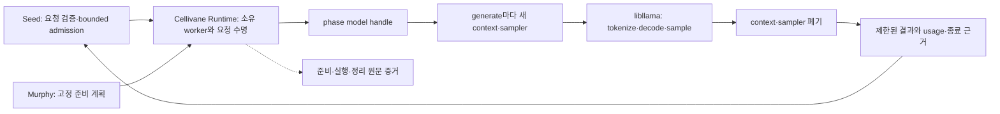

# Cellivane Runtime와 Murphy 0.1

상태: **PARTIAL / 고정 CPU 실제 실행·독립 재판독 PASS, Windows model-free 회귀 583 PASS**. 기준은 공개 beta
`b89273b0e2cbb4ec7a61e1efb02f69beb1d529f1` 이후 승인된 방향이며, 기존 제품은 PARTIAL이다.
검토일 2026-10-15. 아래 고정값은 지원 계약이며 성능 측정값이 아니다. 최초 실행의
source snapshot과 transport·cleanup 보강 뒤 최종 source의 검증 결과는 구분해 보존한다.

## 현재 우선순위

다음 조각은 Cellivane이 소유하는 **Runtime 실행 코어와 준비 단계**다. 여러 HTTP
서빙 엔진을 더 연결하는 일보다 모델·요청·context의 수명을 직접 관리하는 작은
실행 경로를 먼저 완성한다. 별도 upstream 비교에서 정리한 다중 backend·KV tier
연구는 역사적 제안으로 보존하고, 이 문서를 현재 Runtime/Murphy 작업의 우선 가이드로 삼는다.

Cellivane Runtime이 직접 tensor kernel을 새로 구현한다는 뜻은 아니다. 첫 worker는
외부 **libllama C API**를 사용하고, Cellivane은 worker 제어·모델 수명·요청 한도·준비와
실행의 구분·증거를 소유한다. Native C++ worker는 host 프로세스이며 AIOS native
kernel이나 Kernel Room 관리권한으로 승격되지 않는다. 기존 Seed HTTP/adapter 및
bridge·profile 결과는 해당 source snapshot의 역사적 증거로 유지한다.

## 첫 고정 계약

| 항목 | 초기 범위 |
|---|---|
| Tensor library | llama.cpp b11429 / source `d81235049384534c167caea52b85a694f6103d14`의 libllama C API |
| Model | 공식 pinned Qwen3-0.6B Q8_0, 기존 artifact catalog의 정확한 basename·bytes·SHA |
| 실행 | CPU (`gpu_layers=0`), 단일 소유 worker의 생성 직렬화, thread 4 |
| Context / batch / output | context 512, batch 128, 최대 생성 64 token |
| 모델 수명 | phase 동안 model handle 유지; 매 generate마다 새 context와 sampler를 생성·폐기 |
| Seed 연결 | `RuntimeSeedEngine`이 bounded callable로 연결; 64 token 초과를 native dispatch 전에 거부; tensor 함수는 libllama가 수행 |
| Murphy 0.1 | 고정 CPU 준비 계획: load → context allocate/한 번 warm generate (최대 1 token) → context·sampler dispose → READY |
| 비교 baseline | 같은 고정 모델·요청 계약의 `none`; Murphy의 준비 동작 유무를 별도로 기록 |

Model handle을 유지하는 것과 모든 weight page의 물리 RAM 상주·고정은 다르다.
Mmap·OS page cache·page fault·allocator 정책이 관여할 수 있다. 상주 정책을
구현·계측하기 전까지 model load 완료나 process working set으로 전체 tensor residency를
증명했다고 쓰지 않는다. 원본 model 파일의 값·bytes·SHA를 바꾸거나 학습하지 않는다.

공식 artifact pin은 [UPSTREAM](UPSTREAM.md#immutable-official-qwen3-model-artifacts)을
따른다. Pin을 갱신하지 않고 기존 model/binary/build 조합의 호환을 추정하지 않는다.

## 책임과 요청 흐름



이는 책임 흐름이다. 현재 저장된 source는 아래와 연결된다. 실제 CPU 실행과 검증의
정확한 범위는 별도 결과 절과 공개 집계에 기록한다.

| 소유 단위 | 소유할 책임 | 별도로 확인할 경계 |
|---|---|---|
| Native worker / build | 고정 C API binding, model/context/sampler 수명, 제한된 입력·출력 | Header 검토, compile/link 성공, 실제 CPU 실행을 따로 기록 |
| Python Runtime | 단일 소유 worker의 요청·응답 연결, deadline·실패·정리 | Process ready와 유효한 생성 완료를 구분; 다른 실행의 응답 수용 금지 |
| Murphy | 고정 준비 계획, warm request의 별도 기록, 준비 context 폐기 | READY가 실제 사용자 요청의 완료나 가속을 뜻하지 않음 |
| Lab | 동일 source/model/config의 phase 비교와 원문 보존 | 준비 비용·warmup·실제 요청 시간을 섞지 않음 |
| 독립 verifier | 저장된 원문·hash·수명·요청 joins 재판독 | Runtime validator에 판정을 위임하지 않음; hostile process attestation과 구분 |

| 구현 연결 | 현재 저장된 계약 |
|---|---|
| [Native worker](../native/cellivane_runtime/worker.cpp) / [build helper](../tools/hosted/build_cellivane_runtime.py) | 고정 header·license와 CPU library를 hash로 확인해 Windows x64 worker를 compile; build receipt와 별도로 실제 모델 추론을 검증 |
| [Runtime core](../hosted/experimental/cellivane_runtime/core.py) | `NativeRuntime`: `LOADED → PREPARING → READY`, 요청마다 증가하는 ID와 context/sampler ID, 잘못된 native reply는 `POISONED`, 유효한 shutdown ack 뒤 `CLOSED` |
| [Murphy plan](../hosted/experimental/cellivane_runtime/murphy.py) | `MurphyPlan`: `none` 또는 `murphy`, 고정 CPU 값, weight 값 변경·custom repack·자동 선택·native MTP를 수행하지 않는 record |
| [Pipe transport](../tools/hosted/cellivane_runtime_transport.py) | 소유 Windows 프로세스를 suspended 상태로 생성하고 Job 할당 뒤 resume; stdin/stdout/stderr 원문을 별도 저장하는 NDJSON 교환 |
| [실험 CLI](../tools/hosted/cellivane_runtime_lab.py) | `smoke`의 phase 교차 비교와 `serve`의 Seed callable 연결, phase별 model/worker/library 재검사·RAM 사전 계획·원문 snapshot |
| [독립 verifier](../tools/hosted/verify_cellivane_runtime.py) | producer/Runtime을 import하지 않는 저장 원문 재판독; 최종 source 26개·native generation 10개·phase별 cleanup의 기록·연결을 확인해 PASS |

Source별 편집 소유자를 정하고 producer/consumer/verifier를 동시에 식별한다.
단일 source family의 목록·hash와 native build source/header/library/생성 binary의
provenance를 연결해야 한다. 문서 변경은 runtime source 검증을 대신하지 않는다.

## Context 격리와 실패

Murphy의 warm context는 READY 전에 sampler와 함께 폐기한다. 실제 생성도 요청마다
새 context·sampler를 사용하므로 이전 요청의 KV/history를 다음 요청의 cache처럼
승계하지 않는다. 이것은 prefix/KV reuse 성능 기능과 별개다.

Context 생성·decode·sample·결과 framing·dispose 중 실패하면 정상 완료나 READY로
덮어쓰지 않는다. 실패·오염된 context를 재사용하지 않으며 정리 완료를 확인할 수
없는 Runtime은 새 요청을 받아 성공처럼 진행하지 않는다. 요청 timeout, 응답 불명,
worker exit와 model/context release는 각각 기록한다. 단순 client disconnect나
Python callback 종료가 tensor 계산 중단·KV release 증거는 아니다.

기존 Seed 연결에서는 허용된 plain-text 완료·token usage·finish 조건을 지켜야 한다.
Truncation, 잘못된 수치·중복 key·overlarge output·stale request 응답을 fallback 성공으로
바꾸거나 cache하지 않는다. Audit/persistence 실패 시 기존 admission poison 정책을 유지한다.
원문 log와 실패 source snapshot은 보존하고 새 source에서의 PASS로 이전 FAIL을 바꾸지 않는다.
`RuntimeSeedEngine`은 Runtime이 `READY`가 아니면 status의 `poisoned=true`를 반영하고
새 요청을 HTTP 503으로 거부한다. Native reply가 잘못돼 Runtime이 오염됐거나 model이
이미 해제된 상태를 health의 정상 admission으로 표시하지 않는다.

Runtime 입력은 plain `system/user/assistant` message 1..32개이며 user role이 최소
하나 필요하다. Message JSON은 UTF-8 16 KiB 이내, 생성은 1..64 token이고 prompt token과
요청한 최대 생성 token의 합이 context 512를 넘지 않아야 한다. Native parser는 입력
line 65,536 bytes·content 합계 16,384 bytes를 제한하며 Python pipe command는 더 작은
32 KiB로 제한한다. 응답 NDJSON 한 frame은 256 KiB로 별도 제한한다. Core의 text
상한과 전체 frame 상한도 다른 검사다. Python lock으로 Runtime 교환을 직렬화한다.
Seed는 서로 다른 요청의 active 1개·no queue를 유지하고, 동일 in-flight 요청에는 최대
8명의 waiter join을 허용한다. Runtime 객체만의 동시 호출 대기 의미와 혼동하지 않는다.

고정 Qwen3 입력은 확인한 chat template에 nonthinking prefix를 적용한다. 이는 입력
rendering이며 생성 후 `<think>` tag를 지우거나 답변을 바꾸는 정규화가 아니다.
Native의 `length`나 thinking 결과를 완료된 plain answer로 숨기지 않고 기존 Seed
validator가 허용한 subset을 검사한다. 원본 weights 값·파일 bytes는 변경하지 않는다.

Lab의 RAM preflight는 새 host snapshot과 caller가 선언한 model bytes, host 2 GiB,
workspace 512 MiB, headroom 4 GiB를 비교하는 계획이다. 실제 allocator 예약, 물리 page
고정이나 전체 resident weights 증명으로 취급하지 않는다. Seed 연결에서는 cache를 0으로
두며 0.1 자체는 자동 준비 모드 전환이나 계획 탐색을 수행하지 않는다. 별도
[Murphy 0.2 selector](MURPHY_SELECTION.md)는 이 고정 실행 경로 앞에서 시작 전 비용을 비교한다.

## Contract before code, evidence before promotion

[개발 가이드](DEVELOPMENT_GUIDE.md#contract-before-plan-plan-before-execution)의 순서를 적용한다.
첫 patch는 아래 계약과 단위를 닫은 뒤 producer·consumer·negative fixture를 맞춘다.

1. Model/library/build identity, protocol version, phase·request 식별과 단일 writer.
2. 입력 bytes/token/context·출력 bytes/token, 동시 요청, deadline과 worker 종료 의미.
3. 준비 load/allocate/warm/dispose와 실제 generate의 시간 경계, 계산된 token usage 범위.
4. 성공·미지원·실패·불명·poisoned 처리와 callback이 받은 결과의 exact shape.
5. 정리 후 context/sampler/model/worker의 상태를 어떤 원문과 연결해 검증할지.

기존 capability/resource record v1, adaptive summary v2와 새 Runtime 증거를 무조건
같은 schema로 취급하지 않는다. 새 record의 version과 source closure를 명시하고
역사적 verifier·source snapshot·허용 aggregate를 보존한다.

## 증거와 비교 설계

아래 검증 단계는 서로 대체할 수 없다.

| 단계 | 확인 가능한 것 | 확인하지 못하는 것 |
|---|---|---|
| 고정 C API 원문 검토 | 함수·구조·수명 계약과 wrapper 설계 근거 | Build 가능성, CPU·모델 호환, 생성 결과 |
| Native build / fixture | 선택 compiler/linker와 wrapper·framing·실패 경로 | 실제 모델 추론이나 가속 |
| 소유 CPU 실제 실행 | 고정 source/model/library/config에서 준비·생성·정리 | 다른 모델·장치·OS의 범용 지원 |
| 독립 기록 재판독 | 원문 integrity와 field·request·timing·정리의 semantic joins | 새 tensor 실행, PID/적대적 프로세스 인증, 품질 보증 |
| Exact-revision CI | 해당 commit의 fixture와 플랫폼별 skip | 실제 모델 실험의 자동 대체 |

첫 실제 비교는 `none,murphy,murphy,none` 순서의 두 round·네 phase로 실행했다.
각 phase는 같은 두 prompt·동일 모델·샘플링·context·출력 한도를 사용한다.
한 phase의 model은 유지하되 실제 request마다 context/sampler는 새로 만든다.
Murphy warm generation은 준비 증거이며 실제 두 prompt의 요청 수·token·시간과 분리한다.
제어한 순서를 기록해 같은 output의 동등성 범위를 확인하고, 의미 정답률로 승격하지 않는다.

Model hash 검사는 파일을 읽어 **OS page cache를 미리 데울 수 있다**. Model load
시간이 줄었다고 SSD cold-load·weights 최적화로 부르지 않는다. 준비·warmup·첫 실제
생성·이후 생성·동기 증거 쓰기·worker peak를 각 scope로 보존한다. Process peak는
Python·다른 프로세스·GPU·전체 host 메모리를 모두 포함한다는 뜻이 아니다.

Murphy가 준비 시간을 더 쓰고 실제 요청 시간이 줄지 않을 수도 있다. 이 부정 결과도
그대로 보고한다. 동일 측정 범위의 추가 준비비용을 ΔP, 요청당 절감 관측을 ΔG라 하면,
ΔG가 양수일 때만 `N × ΔG > ΔP`인 요청 수에서 상각 가능성을 논의할 수 있다.
ΔG가 0 이하이거나 비교 조건이 다르면 break-even 이익을 주장하지 않는다. 두 round의
작은 실험은 통계적 성능 보장·production speedup이나 새 품질 개선이 아니다.

## 필요한 부정 검증

- 잘못된 model basename/hash/size, library/header/build/binary provenance 불일치, 미지원 설정.
- request·context·batch·output 한도 초과와 Seed의 서로 다른 동시 요청 거부; 동일 in-flight join과 Runtime 교환 직렬화.
- warm 종료 전 READY, request/phase ID 불일치, 중복·잘린 원문과 비정상 token/시간 수치.
- decode·sampler·dispose 실패, worker timeout/exit, 원문 persistence 실패 후 admission 거부.
- warm 또는 이전 request의 context가 실제 요청으로 승계되지 않음과 반복 생성 뒤 정리.
- 준비·실제 요청 시간 혼합, source/model 변경, 누락된 cleanup이 독립 PASS가 되지 않음.

이는 필요한 검증 범위이며 모든 항목이 실제 모델의 fault injection으로 실행됐다는
뜻은 아니다. 실행한 model-free 회귀와 실제 CPU·독립 재판독 결과는 아래에 범위를 나눠 기록한다.

## Build와 실행

실험 CLI는 필수 `--worker-exe`, `--build-receipt`, `--asset-root`, `--model-file`,
`--storage-root`를 받는다. `--asset-root`는 기존 pinned b11429 asset을 보유한 local
root여야 하며 CLI가 임의 engine을 자동 다운로드하지 않는다. `--mode smoke`는
`--repeat 1|2`(기본 2)의 비교이고, `--mode serve`는 Murphy를 준비한 뒤 기본 port 18981의
loopback Seed를 Ctrl+C까지 연다. 현재 transport와 worker build는 Windows x64 CPU만
지원하며 Visual Studio 2022 Build Tools의 x64 C++ compiler가 필요하다. Build helper는
기본 Build Tools 위치를 사용하며 별도 설치 위치는 `--vs-root`로 지정한다.

다음 명령은 repo root의 PowerShell에서 실행한다. 기본 저장 위치는 local app data이며
용량이 충분한 local D: 디렉터리를 선택하려면 `$taskRuntime`, `$taskModels`, `$taskAssets`를
해당 절대경로로 설정한다. Header·license와 model/library bytes는 repo에 넣지 않는다.

```powershell
$taskAssets = Join-Path $env:LOCALAPPDATA 'Cellivane/llama-assets'
$taskModels = Join-Path $env:LOCALAPPDATA 'Cellivane/seed-models'
$taskRuntime = Join-Path $env:LOCALAPPDATA 'Cellivane/runtime-murphy'
py -3 -B tools/hosted/cellivane_llama_assets.py --asset-root $taskAssets --download-assets
if ($LASTEXITCODE -ne 0) { throw 'Pinned llama.cpp asset preparation failed' }
py -3 -B tools/hosted/cellivane_seed_assets.py --model 0.6b --storage-root $taskModels
if ($LASTEXITCODE -ne 0) { throw 'Pinned model preparation failed' }
$taskTiny = Join-Path $taskModels 'models/Qwen3-0.6B-Q8_0.gguf'
$taskEngine = Join-Path $taskAssets 'llama.cpp-b11429-cpu'
$taskBuildText = py -3 -B tools/hosted/build_cellivane_runtime.py --output-root $taskRuntime --engine-dir $taskEngine --download-inputs
if ($LASTEXITCODE -ne 0) { throw 'Native worker build failed' }
$taskBuild = $taskBuildText | ConvertFrom-Json
$taskWorker = $taskBuild.executable.path
$taskReceipt = $taskBuild.receipt
py -3 -B tools/hosted/cellivane_runtime_lab.py --mode smoke --worker-exe $taskWorker --build-receipt $taskReceipt --asset-root $taskAssets --model-file $taskTiny --storage-root $taskRuntime --repeat 2 | Tee-Object -Variable taskSmokeLines
if ($LASTEXITCODE -ne 0) { throw 'Runtime smoke did not complete' }
$taskSummary = ($taskSmokeLines[-1] | ConvertFrom-Json).summary
py -3 -B tools/hosted/verify_cellivane_runtime.py $taskSummary --source-root (Get-Location).Path
```

Build 결과의 `receipt`와 `executable.path`는 매번 생성한 `builds/<UUID>` 안을 가리킨다.
그 디렉터리의 `engine-cpu`가 고정 CPU DLL 집합이고, receipt는 header·license·source·
compiler 인자·binary hash를 기록한다. `COMPILED`와 receipt의 `runtime_tested=false`는
compile 증거이며 실제 모델 실행 PASS를 뜻하지 않는다. `--download-inputs`는 없거나
검증되지 않은 임의 header를 수용하는 옵션이 아니다. 고정 공개 파일만 내려받아 hash를 확인한다.

위 독립 verifier는 기본 두 round의 네 phase 계약을 재판독한다. `--repeat 1`은 작은
producer 진단용이며 그 결과를 이 네 phase verifier의 PASS로 부르지 않는다. `--source-root`
없이도 보존 snapshot을 검사하고, 지정하면 해당 실제 source와의 byte 일치도 확인한다.

같은 PowerShell의 준비·build 변수를 사용해 다음을 실행하면 Murphy 준비 후 계속
서빙한다. 이 명령은 Ctrl+C까지 block하므로 HTTP 요청은 별도 PowerShell에서 보낸다.

```powershell
py -3 -B tools/hosted/cellivane_runtime_lab.py --mode serve --worker-exe $taskWorker --build-receipt $taskReceipt --asset-root $taskAssets --model-file $taskTiny --storage-root $taskRuntime --port 18981
```

요청에는 `max_tokens` 1..64, `temperature=0`, `stream=false`를 명시한다. 기존 Seed의
생략 시 기본값 128은 이 경로에서 HTTP 400이며 native dispatch 전에 거부한다.
모델 alias는 `cellivane-runtime-target`이다.
이 launcher의 `GET /v1/status`는 선택적인 `tensor_backend` 표시를 `libllama-c-api`로
설정한다. 이는 이 경로의 library 실행 방식을 설명하는 metadata다. 기존 외부 backend를
쓰는 Seed의 기본 계약과 관리권한을 바꾸거나 실제 loader attestation을 제공하지 않는다.

```powershell
$taskBody = @{ model='cellivane-runtime-target'; messages=@(@{role='user'; content='Reply with exactly OK. /no_think'}); max_tokens=64; temperature=0; stream=$false } | ConvertTo-Json -Depth 5
Invoke-RestMethod -Uri 'http://127.0.0.1:18981/v1/chat/completions' -Method Post -ContentType 'application/json; charset=utf-8' -Body ([Text.Encoding]::UTF8.GetBytes($taskBody))
```

## 최종 검증과 측정 범위

[공개 집계](benchmarks/2026-10-15-runtime-murphy-summary.json)는 최종 실행
`5c92c4d2-888b-4deb-8141-c559b0af7e71`의 allowlisted metadata와 기록 hash를 담는다.
Pinned Qwen3-0.6B Q8_0 CPU, `none,murphy,murphy,none` 네 phase에서 실제 요청 8개와
Murphy warmup 2개를 실행했다. 독립 재판독 PASS는 source 26개·native generation 10개·
소유 worker 네 개의 정상 cleanup·원문 요청/결과 연결을 확인한 범위다. Token을 별도
tensor 실행으로 재계산하거나 token-to-text를 독립 decode한 검증은 아니다.

덧셈의 숫자 값은 맞았지만 only-number 지시를 지키지 않았고, 단어 출력 지시는 준수했다.
두 고정 입력의 텍스트는 네 phase에서 같았다. 실제 답변 원문·prompt·PID·절대경로·
engine log는 private evidence로 보존하며 공개 문서에 싣지 않는다. 이 두 입력은
품질 향상이나 일반 정확도 벤치마크가 아니다.

| 항목 | 현재 확인 | 범위 |
|---|---|---|
| 보강 뒤 최종 실제 실행·독립 재판독 | PASS | source 26개, 4 worker phase·8 measured·2 warmup·10 native generation, 정상 cleanup |
| 최종 Windows model-free 회귀 | 583 PASS / 0 skip / 0 failure, 74.406 s | native protocol selftest를 `CELLIVANE_RUNTIME_SELFTEST_EXE`로 명시 활성화; unittest는 모델을 실행하지 않음 |
| 별도 실제 HTTP·기존 bridge 관측 | PASS | health·모델 목록, 직접 computed 1개·bridge CONFIRMED probe와 ANSWERED 1개, 최대 65 token 요청 HTTP 400·추가 native dispatch 0개, cleanup 뒤 port closed |
| 새 commit의 CI | 별도 확인 | 과거 revision의 green으로 대체하지 않음 |

HTTP/bridge 관측 실행은 `e61f3a0a-f804-4bf6-a5e8-1c23dd1ecddc`이다. Warmup을 포함한
native generation은 3개이며 위 네 phase 독립 protocol replay와 별도 관측이다.
최초 실행 `804b40ef…`와 당시 source snapshot·원문은 역사적 증거로 보존했고, 최종
보강 결과로 이전 source의 hash나 verdict를 덮어쓰지 않았다.

아래 값은 **각 mode에서 fresh worker 2개와 실제 요청 4개를 합한 시간**이다. 모델 load와
Murphy 준비 비용을 포함하며, worker 두 개를 차례로 새로 만든 실험의 합계다.

| Mode | 준비 합계 (s) | 실제 요청 wall 합계 (s) | 준비 + 실제 요청 (s) |
|---|---:|---:|---:|
| none | 0.8900313 | 0.8103823 | 1.7004136 |
| murphy | 1.0440375 | 0.7679800 | 1.8120175 |

Murphy의 실제 네 요청 합계는 42.4023 ms 짧았지만 준비 합계는 154.0062 ms 늘어,
**준비+실제 요청 합계는 111.6039 ms 더 느렸다**. 요청마다 이만큼 절약된다는 뜻이
아니며, 작은 교차 실험으로 지속적인 요청당 절감이나 break-even 수를 확정하지 않는다.
일반 가속·production throughput·품질 향상 결론은 없다.

네 worker의 lifetime peak 중 최대는 762,396,672 bytes, 약 727.08 MiB였다. 이는 native
worker의 lifetime working set이며 Python·다른 프로세스·GPU·host 전체 메모리를 제외한다.
메모리 예약·강제 quota나 모든 weight page의 물리 residency를 증명하지 않는다.

새 summary는 schema 1, smoke scope `runtime-murphy-cpu-smoke`다. Phase의
`preparation.load_wall_s`는 worker 생성부터 ready 수신까지의 Python wall time,
`warmup_wall_s`는 `prepare()` 구간, `preparation_s`는 그 합이다. Native reply의
`prefill_s`, `decode_s`, `elapsed_s`와 Python request의 `wall_s`는 각 측정 구간이
다르다. 특히 transport는 원문 flush·동기 쓰기도 수행하므로 wall time을 순수 tensor
계산 시간으로 읽지 않는다. `peak_working_set_bytes`는 native worker의 process peak다.
Pipe write와 reply는 하나의 monotonic deadline을 공유하고 실패 시 worker를 종료한다.
동기 disk write·flush·fsync가 OS 안에서 block한 경우를 취소하는 기능은 없으므로 이
deadline을 hard filesystem I/O quota나 전체 작업의 절대 wall-time 보장으로 읽지 않는다.

과거 profile·bridge·speculation 또는 CI PASS는 새 wrapper·Runtime을 검증하지 않는다.

## 지원하지 않는 기능과 연구 목표

초기 구현은 고정 CPU 준비 계획이다. 원본 weights 값 변경, custom repack, 모델
partition, GPU, DLM 변환, native MTP, 엔진 간 KV 공유, SSD weight/KV paging,
임의 모델·하드웨어 자동 최적화는 포함하지 않는다. 이 방향을 목표로 논의할 수는
있지만 **RESEARCH**이며 Murphy 0.1의 구현·성능으로 소개하지 않는다.

Native tensor kernel을 새로 소유하는 일, 학습·양자화 변경과 품질 개선, native
Kernel Room binding도 별도 설계·구현·증거가 필요하다. 현재의 library binding이나
model load를 그 완성으로 부르지 않는다. 외부 library·header의 license/notice와
build provenance는 [UPSTREAM](UPSTREAM.md)의 원칙을 유지한다.

다음 후보는 동일 provider 안의 bounded 입력 준비, CPU/GPU capability 관측과 batch
계획이다. 먼저 모델·출력 동등성, 준비와 요청 비용, 실패·정리 한도를 실측한 뒤 범위를
넓히는 **RESEARCH**다. 이 Runtime/Murphy 경로의 GPU 실행·다중 provider 지원·자동
하드웨어/준비 계획 선택은 아직 구현하지 않았으며 이번 CPU 결과로 승격하지 않는다.
기존 adaptive launcher의 시작 mode 선택과는 별도 범위다.

0.1의 자동 선택 미구현 경계와 별도로, [Murphy 0.2](MURPHY_SELECTION.md)는 새 companion과
controller closure를 요구하는 시작 전 `none`/`murphy` 선택 계약이다. 별도
[0.2 집계](benchmarks/2026-10-15-murphy-selection-summary.json)는 N=1·N=1024의 실제 none 선택,
제한된 실행 관측·choice 재판독과 631 Windows model-free 회귀 PASS를 기록한다. 비용식에서 제외한
controller·calibration 비용과 실제 1024회 실행이 아니라는 한계는 새 정본을 따른다.
이 문서의 0.1 source·raw·aggregate를 변경하거나 새 policy의 검증 결과로 승계하지 않는다.
