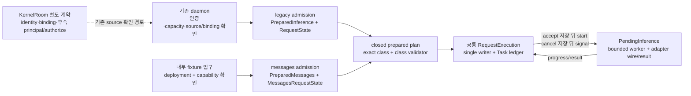

# AIOS 구조 비교와 2026-10-08 채택 기록

> 문서 역할: 공식 upstream 설계 비교·제한된 구조 변경의 결정과 증거 기록
>
> 문서 수명주기: 활성 참고; 제품·Kernel Room·서빙 계약의 정본을 대체하지 않는다.
>
> 내용·외부 자료 확인일: 2026-10-08
>
> 분류: 자료는 `SOURCE_CURATION` / `RESEARCH`, 채택한 hosted 책임 분리는 `SUPPORTING` / 개발 `PARTIAL`. 새 변경의 실행 판정은 §6에서 별도로 기록한다.
>
> 상위 정본: [제품 방향](../meta/aios_product_direction_ko.md), [유일한 전역 큐](../meta/minimal_io_and_maturity_workflow_ko.md#structure-optimization-current), [Kernel Room 관리 모델](../kernel-room/kernel_room_management_model_ko.md), [서빙 개발 계약](aios_serving_design_ko.md), [Linux 실행 기반·반입 정책](linux_hosted_substrate_and_resource_policy_ko.md)

## 1. 조사와 변경의 범위

사용자는 온라인 유사 프로젝트를 조사해 AIOS 구조를 최적화하도록 요청했다.
비교는 서빙, 에이전트 실행, 관리 권한, native kernel의 네 책임을 구분해 수행한다.
이 저장소의 AIOS는 독자 native x86_64 커널과 `Room -> Cell -> Node -> NodeBit` 관리
계약을 유지하며, bounded Linux-hosted runtime을 기본 delivery로 발전시키는 프로젝트다.
같은 이름을 사용하는 agiresearch/AIOS와 구현·프로젝트 identity를 공유하지 않는다.
agiresearch/AIOS의 [README](https://github.com/agiresearch/AIOS)는 그 kernel을 host OS kernel
위의 추상화 계층으로 설명한다. 그 [syscall 문서](https://docs.aios.foundation/aios-docs/aios-kernel/syscalls)의
Python Thread/Event 기반 agent-service 호출을 이 저장소의 native syscall ABI와 구별한다.

조사는 공식 문서와 upstream의 공개 라이선스 파일을 읽은 범위다. 아래 upstream의
프로그램·모델·VM·GPU를 실행하거나 설치한 결과가 아니다. 공개 설계를 읽고 AIOS의
기존 책임을 다시 나눈 것이며 upstream 코드·예제·도표를 복사, vendoring, import하지
않았다. schema1의 기존 resource13과 `code_import=0`은 유지한다. 이 비교 표는 그
manifest의 추가 row나 새 지원 목록이 아니다.

변경 출발점은 `work/serve-p0-20261008`의 미커밋 SERVE-P0 구현과 보존한 검증이다.
기존 ROOT 및 ego 방향 worktree의 사용자 변경은 옮기거나 정리하지 않았다.
[후속 기준선](../../build/structure-optimization-20261008/baseline.json)은 변경 전 source와
SERVE-P0 증거 묶음 identity를 기록한다. [P0 검증 기록](aios_serving_design_ko.md#6-검증-기록)은
당시 source를 대상으로 한 기록으로 보존하며, 새 source의 PASS로 승계하지 않는다.

## 2. 공식 자료와 provenance

아래 모든 URL의 확인일은 **2026-10-08**이다. 버전이 붙은 문서도 내용·라이선스 파일의
immutable commit/hash를 확보한 것은 아니다. `latest`, `main`, `master`와 버전 없는
문서는 움직이는 연구 참조다. 실행 호환·빌드 dependency·라이선스 compatibility 검토를
완료한 pin으로 사용하지 않는다. 라이선스 열은 직접 확인한 공표 범위만 기록하며
그 밖의 문서·모델·dependency·개별 파일은 별도 검토가 필요하다.

| 프로젝트·문서 | 공식 근거와 확인 범위 | revision·라이선스 확인 | 이번 사용 |
|---|---|---|---|
| KServe | [0.17 architecture](https://kserve.github.io/website/docs/0.17/concepts/architecture): inference service 관리와 실제 inference의 control/data plane 분리 | 문서 edition 0.17; commit 미고정. [master LICENSE](https://raw.githubusercontent.com/kserve/kserve/master/LICENSE) Apache-2.0 직접 확인; 문서·dependency의 개별 조건은 미검토 | 책임 분리 비교; Kubernetes·KServe 코드 도입 0 |
| vLLM | [architecture overview](https://docs.vllm.ai/en/latest/design/arch_overview/): API server, engine core, GPU worker 책임 구분 | `latest` 문서; commit 미고정. [main LICENSE](https://raw.githubusercontent.com/vllm-project/vllm/main/LICENSE) Apache-2.0 직접 확인; 모델·dependency 조건은 미검토 | 엔진/입구/worker 경계 비교; vLLM 코드·실제 GPU 실행 0 |
| llama.cpp | [master server design](https://github.com/ggml-org/llama.cpp/blob/master/tools/server/README-dev.md): JSON/template routes, context/slot, 별도 server_models 책임 | 움직이는 `master`·commit 미고정; 라이선스 미검토 | 현재 legacy/P1 경계에 가까운 구조 참조; 설치·호환 실행·코드 도입 0 |
| Ollama | [chat API](https://docs.ollama.com/api/chat): role/content messages, stream 기본 true, keep_alive0의 model unload | 버전 없는 공식 문서·commit 미고정; 라이선스 미검토 | messages protocol 계획과 request cancel/model lifetime 구분; 설치·호환 실행·코드 도입 0 |
| agiresearch/AIOS | [공식 저장소](https://github.com/agiresearch/AIOS), [module overview](https://docs.aios.foundation/aios-docs/aios-kernel/overview), [scheduler](https://docs.aios.foundation/aios-docs/aios-kernel/scheduler), [syscalls](https://docs.aios.foundation/aios-docs/aios-kernel/syscalls) | 버전 없는 문서·commit 미고정. [main LICENSE](https://github.com/agiresearch/AIOS/blob/main/LICENSE)는 확인 당시 0 lines/1 byte로 라이선스 본문·사용 허가를 확인하지 못함; SPDX 추정 안 함 | hosted agent runtime 비교; native syscall·kernel identity 대체 0 |
| Microsoft Semantic Kernel | [filters](https://learn.microsoft.com/en-us/semantic-kernel/concepts/enterprise-readiness/filters): 실행 입구의 context와 continuation으로 실행을 제어 | 공식 문서의 확인일만 고정. [main LICENSE](https://github.com/microsoft/semantic-kernel/blob/main/LICENSE) MIT 직접 확인; 개별 파일·문서 조건은 미검토 | admission 검증 위치 비교; framework·plugin 도입 0 |
| WebAssembly Component Model / WASI | [WIT worlds](https://component-model.bytecodealliance.org/design/worlds.html), [WASI security](https://wasi.dev/security) | 버전 없는 공식 문서; 관련 코드·문서 라이선스 미검토 | interface와 실행 권한의 구분 비교; WASM runtime 도입 0 |
| seL4 | [capabilities](https://docs.sel4.systems/Tutorials/capabilities.html), [verified configurations](https://docs.sel4.systems/projects/sel4/verified-configurations.html) | 버전 없는 문서·commit 미고정. [공식 licensing](https://sel4.systems/Legal/license.html): kernel/proofs GPLv2, user code/proof libraries BSD 2 Clause, 문서 Creative Commons Attribution-ShareAlike; 개별 파일 SPDX 우선 | 권한·proof 범위 비교. 기존 reference-only row 유지; 커널·증명·코드 도입 0 |
| Genode | Foundations25.05 [recursive structure](https://genode.org/documentation/genode-foundations/25.05/architecture/Recursive_system_structure.html), [resource trading](https://genode.org/documentation/genode-foundations/25.05/architecture/Resource_trading.html) | 문서 edition25.05; commit 미고정. [공식 licensing](https://genode.org/about/licenses): framework primary AGPLv3와 commercial 선택; 개별 자료·파일 조건은 미검토 | 소유·서비스·자원 책임 비교; manifest row 추가·framework 도입 0 |
| Cognee | [공식 저장소](https://github.com/topoteretes/cognee)의 agent memory/knowledge graph 목적 | 움직이는 저장소 참조·commit 미고정. [main LICENSE](https://github.com/topoteretes/cognee/blob/main/LICENSE) Apache-2.0 직접 확인; 개별 파일·dependency 조건은 미검토 | 장기 기억 분야의 별도 비교 후보; 이번 기억 구현·도입 0 |

위 라이선스 표는 재사용 승인이 아니다. 향후 코드나 파생물을 들여오려면 exact
revision/integrity, 개별 license/SPDX, provenance, destination/owner/update/rollback,
별도 검증을 [반입 정책 §10](linux_hosted_substrate_and_resource_policy_ko.md#10-code-import와-공급망-경계)에
따라 다시 고정해야 한다. 이번 조사로 기존 manifest의 확인일이나 pin을 갱신하지 않는다.

## 3. 확인한 설계와 AIOS 적용 판단

`공식 자료` 열은 upstream이 설명하는 설계다. `AIOS 판단`은 현재 정본·구현을 기준으로
선택한 해석이며 upstream의 실행·보안·성능 보증이 AIOS에 이전된다는 뜻이 아니다.

| 축 | 공식 자료에서 확인한 내용 | AIOS 판단·채택 범위 | 이번 미구현 범위 |
|---|---|---|---|
| 서빙 관리/실행 | KServe는 service lifecycle·resource orchestration과 inference 실행을 구분한다. [근거](https://kserve.github.io/website/docs/0.17/concepts/architecture) | service/backend 소유·binding 확인은 기존 daemon/관리 경로가, engine wire 형식과 결과 검증은 adapter가, Task 전이는 공통 lifetime이 소유한다 | Kubernetes controller, autoscale, Knative, inference DAG |
| 입구/엔진/worker | vLLM은 HTTP/input 처리, engine scheduling/KV cache, GPU worker 실행을 구분한다. [근거](https://docs.vllm.ai/en/latest/design/arch_overview/) | 현재 bounded worker의 실행 제어가 legacy 직렬화·receipt 재구성에 의존하지 않도록 prepared 계약을 소비한다 | continuous batching, KV cache scheduler, multi-GPU/distributed execution; 속도·처리량 향상 판정 |
| HTTP 형식/instance 수명 | llama.cpp는 routes의 JSON/template 처리, context/slot 실행, 독립 server_models를 구분한다. [근거](https://github.com/ggml-org/llama.cpp/blob/master/tools/server/README-dev.md) | adapter가 wire 형식을 소유하고 공통 worker는 closed prepared plan을 소비한다. 실제 instance 소유·start/stop은 별도 기존 backend 계약이다 | llama.cpp server 연결, 다중 model router·slot batching, 실제 owned instance acceptance |
| messages/stream/model 잔류 | Ollama chat은 role/content와 기본 stream=true, keep_alive0 unload를 설명한다. [근거](https://docs.ollama.com/api/chat) | 현재 messages fixture는 wire의 stream=false를 제출 전에 고정한다. P1 실제 adapter도 기본값에 맡기지 않고 명시해야 한다. model unload, 요청 취소, 전체 service stop은 다른 행동이다 | Ollama 연결·stream parser·keep_alive 조작·실제 cancel proof; 현재 fixture는 호환 증거 아님 |
| 에이전트 요청 관리 | agiresearch/AIOS는 module별 요청 큐를 scheduler가 관리하고 LLM/context/memory/storage 책임을 구분한다. [개요](https://docs.aios.foundation/aios-docs/aios-kernel/overview), [scheduler](https://docs.aios.foundation/aios-docs/aios-kernel/scheduler) | 요청 접수·수명과 engine별 형식 처리를 분리하는 원칙을 사용한다. 모델 문맥·runtime 메모리·영속 저장도 개념상 분리한다 | FIFO/RR 큐, time-slice/suspend-resume, smart routing, 장기 기억 구현; 현재 active1은 큐·preemption 아님 |
| 실제 실행 입구 | Semantic Kernel filter는 continuation을 호출해야 다음 단계가 실행된다. [근거](https://learn.microsoft.com/en-us/semantic-kernel/concepts/enterprise-readiness/filters) | 유효한 prepared 입력의 검증을 worker 시작 이전 공통 소비 경계에 둔다. 새 선언만으로 우회 방지나 권한을 주장하지 않는다 | Semantic Kernel 의존성, 자동 tool call, 전체 framework filter 체계 |
| interface/행동 | WIT world는 import/export surface를 정의하며 내부 동작을 정의하지 않는다. [근거](https://component-model.bytecodealliance.org/design/worlds.html) | EngineSpec/CapabilityReport의 shape·지원 상태와 실제 wire/취소/결과 증거를 별도로 확인한다 | WIT ABI, WASM component나 sandbox 지원 |
| 기능/권한 | seL4 capability는 객체 접근 권한인 위조 불가능한 token이다. WASI는 host가 부여한 권한을 실행 경계에서 제한한다. [seL4](https://docs.sel4.systems/Tutorials/capabilities.html), [WASI](https://wasi.dev/security) | CapabilityReport는 deployment별 기능 지원 증거다. 권한 grant, NodeBit validity, principal/ownership/authorize, backend stop 권한을 대신하지 않는다 | seL4 CSpace/revocation 또는 WASI sandbox, native K5 authorize/enforcement |
| 소유/연결 | Genode는 parent의 소유 관계와 client/server session 연결을 구분하고 parent가 session 요청을 중재한다. [근거](https://genode.org/documentation/genode-foundations/25.05/architecture/Recursive_system_structure.html) | Cell의 관리 관계, source identity, deployment ownership, 요청별 worker 수명을 서로 명시적으로 연결한다. attached service에 요청을 보낼 수 있다는 사실을 전체 서버 종료 권한으로 해석하지 않는다 | Genode component/PD와 Cell의 동일시, parent broker 구현, 다중 Cell service routing |
| 자원 책임 | Genode는 PD별 quota와 parent-child budget 분할, client/server session 비용을 명시한다. [근거](https://genode.org/documentation/genode-foundations/25.05/architecture/Resource_trading.html) | 장기 instance/model 자원과 요청·buffer·handle 자원 책임을 구분하는 후속 원칙을 기록한다. 현재 CPU/RSS 관측과 Task 상한은 quota 집행 증거가 아니다 | RAM/GPU hard quota, 자원 반환·crash reconciliation, K4/K5 적용 |
| native 증거 | seL4는 architecture/platform/configuration과 source version별 verified 범위를 명시한다. [근거](https://docs.sel4.systems/projects/sel4/verified-configurations.html) | AIOS native K1/K2-a, H1 host-only replay, hosted source를 각자 검증한다. 외부 formal proof와 현재 fixture를 native 전체 보안 증명으로 승격하지 않는다 | native kernel replacement, seL4/Genode port, AIOS formal proof 완료 주장 |

관리 의미의 정본은 계속 Kernel Room이다. Genode의 component/protection domain이나
seL4의 kernel object를 Cell/Node/NodeBit에 이름만 바꿔 넣지 않는다. 현재
`management_only=1`·`observation_only=1`과 namespace/generation/source binding 규칙,
K1 1024B·K2-a 256B native ABI, 9개 gate의 분류 메타데이터 의미를 유지한다.

## 4. 이번에 채택한 구조 변경

이번 구현은 현재 두 프로토콜의 내부 계약을 명확히 하는 작은 hosted 변경이다.
기존 engine adapter와 Task state를 다음 책임으로 나눈다.



그림의 messages 입구는 fixture 전용이다. 새 CLI/RPC engine 선택·HTTP facade나
canonical MAIN binding으로 읽지 않는다. 기존 daemon의 인증·capacity·source 검증과
backend terminal 확인을 공통 lifetime으로 옮기지 않는다.

| 코드 책임 | 변경 전 문제 | 채택한 변경 | 보존할 검증 의미 |
|---|---|---|---|
| `PreparedInference` / `PreparedMessages` | worker가 일부 prepared 종류의 legacy receipt 검증을 직접 재구성함 | sealed prepared object 각각이 `validate_prepared()`를 소유하고 대칭적인 소비 계약을 제공 | forged/unsealed/변조한 packet을 subprocess 생성 전에 거절 |
| `PendingInference` | worker lifetime과 legacy 직렬화/receipt reconstruction 분기가 결합됨 | 허용된 exact class의 `type(prepared).validate_prepared(prepared)`로 검증하고 worker packet·result 계약을 소비 | exact wire bytes·legacy receipt3·오류 어휘·cancel/result 순서 유지 |
| `RequestExecution` | messages fixture가 legacy 전용 인자에 `None`을 전달해 공통 생성 경로를 재사용함 | legacy/messages admission 경로를 명시하고 공통 lifetime 초기화를 분리 | 첫 save 뒤 dispatch, 취소 save 뒤 signal, terminal once-only와 실패 poison 유지 |

sealed prepared object는 이 Python runtime 내부의 불변식이다. 커널의 위조 불가능한
capability, 서로 신뢰하지 않는 process의 security boundary 또는 native authorize가
아니다. 내부 API 정리로 인정할 범위를 넘겨 설명하지 않는다.

독립 검토는 instance에 같은 이름의 validator를 덮어씌우면 동적 method 호출을 우회할
수 있음을 발견했다. 제어된 mock 재현은 `Popen` 시도1·실제 spawn0을 보였으며
[원본 재현](../../build/structure-optimization-20261008/validator-shadow-reproduction.json)을
보존한다. frozen dataclass 선언은 self-authentication이 아니다. exact class allowlist
뒤 class validator를 직접 호출하도록 수정하고 shadow/변조 입력의 spawn0 부정 검사를
보강했다. result validator도 두 prepared class의 고정 dispatch를 사용하며 양쪽 shadow
반례를 확인한다. 수정 전 narrow62와 첫 broad 실행은 interim 기록이며 최종 수정
source의 검증으로 사용하지 않는다.

public CLI/RPC, receipt3, schema와 source 목록의 identity/count를 유지한다.
MAIN protocol6/run7/source32, backend protocol1/run2/source19,
CLI0.11.0/session11/source39, 전체 hosted Python source43은 그대로다.
global active1·Task16·event64도 그대로이며 새 queue나 병렬 실행을 추가하지 않는다.
source 파일 수가 같아도 runtime bytes와 manifest hash는 달라지므로 새 검증을 저장한다.

## 5. 보류한 확장과 제품 큐

이번 채택은 책임 결합을 줄여 후속 engine 구현과 검증의 경계를 명확히 하려는
구조 변경이다. 실행 시간·token throughput·latency·메모리 절감 benchmark는
실행하지 않았다. 구조가 단순해졌다는 판단을 성능 향상 수치로 바꾸지 않는다.

Kubernetes/Knative 설치, 자동 확장, inference DAG, continuous batching, 분산 worker,
multi-GPU, 장기 기억 engine, WASM sandbox, seL4/Genode 통합·native replacement는
이번 구현에서 보류한다. 실제 서버·stream facade·canonical binding의
[SERVE-P1 후보](aios_serving_design_ko.md#7-다음-한-조각)는 `PLANNED`로 유지한다.
구현 착수와 acceptance는 [전역 큐](../meta/minimal_io_and_maturity_workflow_ko.md#structure-optimization-current)에서 선택한다.

독자 native kernel과 portable 설치·기본 운용, 심핵과 위임·철회 가능한 높은 권한의
로컬 LLM 집행은 기존 제품 목표다. [portable 우선 목표](../meta/minimal_io_and_maturity_workflow_ko.md#portable-basic-next)의
고정 UEFI VM·서로 다른 물리 시스템 두 종류 acceptance는 이번 hosted 변경으로
달성되지 않았다. source43 운영 이미지도 candidate manifest만이며 실제 acceptance는
미지원/`NOT_RUN`이다. 역사 연구의 FAIL/NOT_EVALUABLE/STATIC_ONLY와 round08 P2는
이번 비교·refactor로 재검토하거나 수정한 결과가 아니다.
현재 CLI11 EvidenceReport producer와 역사 schema10 validator의 runtime 결합도 계속
미지원이다. TaskSmoke의 session10/11 reader·uniform source 검사를 이 결합이나
source43 이미지 qualification으로 승격하지 않으며 실제 QEMU 재실행은 없다.

## 6. 후속 source와 검증 기록

새 기록은 `build/structure-optimization-20261008/`가 소유한다. 변경 전 SERVE-P0의
source/evidence 묶음과 `build/serve-p0-20261008/` 원본을 보존한다. P0의 전체1055/skip85,
후속 pure verifier11·source32 fixture PASS는 역사 기준선이며 새 source에 승계하지 않는다.

| 대상 | 판정 | 범위·근거 |
|---|---|---|
| 공식 자료 조사·기존 정본 대조 | 내용 검토 완료 | 2026-10-08의 §2 URL; 실행·성능·license compatibility 보증 아님 |
| adapter/lifetime 후속 회귀 | `PASS` | 최종4 modules·66 PASS·0 skip·6.833초; class validator/result dispatch의 양방향 shadow 반례·legacy parity·두 admission 경로의 공통 수명. [최종 narrow 로그](../../build/structure-optimization-20261008/adapter-lifetime-final-regressions.log) |
| 후속 hosted 전체 회귀 | `PASS` | Windows Python3.11.9·1063 수집·978 실행 PASS·85 skip·363.045초·exit0. [최종 전체 로그](../../build/structure-optimization-20261008/full-hosted-regressions-final.log); P0 전체1055·interim1059와 구별 |
| 새 source32 fixture·독립 판독 | `PASS` | 새 raw worker artifact의 snapshot3·ANSWERED/source32, 독립 CLI exit0. [판정](../../build/structure-optimization-20261008/final/messages-independent-verdict.json); 실제 엔진 호환·process liveness false |
| Linux durable file/crash·process fixture | `NOT_RUN` / `BLOCKED_ENV` | 기존 WSL `Wsl/CallMsi/Install/REGDB_E_CLASSNOTREG` 한계 유지; Windows callback/mock 검사와 구별 |
| 실제 모델·두 서버·stream·GPU·이미지·QEMU·실기기 | `NOT_RUN` | 이번 내부 refactor 검증으로 대체하지 않음 |
| 성능·비용 benchmark | `NOT_RUN` | 같은 모델/환경/workload의 비교 실행 없음 |

첫 broad 실행은 1059개·skip85·357.292초·exit0이지만 shadow 수정 전 collection/source를
사용했으므로 [interim 로그](../../build/structure-optimization-20261008/full-hosted-interim.log)로
보존한다. 최종 source32 manifest SHA256은
`fe51c53591e2cca9e49d3b85021ee0451a1a598fe34801edb7b9445f0b43d7e9`다.
이 hash는 MAIN runtime32의 source manifest identity이며 새 비교 문서·mirror·turn delta
전체의 hash가 아니다. 문서 수정은 source 파일 수를 늘리거나 해당 runtime hash를
바꾸지 않는다. 변경 파일 목록과 turn delta는 증거 묶음에서 별도 기록한다.
새 [source manifest](../../build/structure-optimization-20261008/final/source-manifest.json)와
[raw artifact](../../build/structure-optimization-20261008/final/messages-task.json)를 기준으로
독립 판독과 최종 전체 회귀를 PASS로 확인했다. raw artifact SHA256은
`cfdae6f0107a1957c644b809f41c8d7d65cb2e28ad36ec104cbb9ab28e20ce31`다.
[기계 판독 결과](../../build/structure-optimization-20261008/final/validation-results.json)는
로그 파싱 수치·source/hash·독립 verdict·미실행 범위를 기록한다. 최종 narrow66과
전체1063은 겹치는 검사 범위이므로 합산하지 않는다. 성숙도는 `SUPPORTING` / `PARTIAL`이다.

최종 narrow의 재현 진입은 다음과 같다. 해당 로그는 아래4 modules를 대상으로 한다.

```powershell
py -3 -B -m unittest discover -s tools/hosted/tests -p "test_hosted_engine_legacy.py" -v
py -3 -B -m unittest discover -s tools/hosted/tests -p "test_hosted_engine_messages.py" -v
py -3 -B -m unittest discover -s tools/hosted/tests -p "test_hosted_async_inference.py" -v
py -3 -B -m unittest discover -s tools/hosted/tests -p "test_hosted_request_runtime.py" -v
```

전체 회귀와 새 raw fixture 독립 판독의 진입은 다음과 같다. 로그의 실제 완료 판정과
source manifest를 확인하며 명령 표시를 실행 PASS로 해석하지 않는다.

```powershell
py -3 -B -m unittest discover -s tools/hosted/tests -p "test_*.py" -v
py -3 -B tools/hosted/verify_engine_fixture.py --artifact build/structure-optimization-20261008/final/messages-task.json --source-manifest build/structure-optimization-20261008/final/source-manifest.json --source-root build/structure-optimization-20261008/final/runtime-source
```

새 로그의 collected/executed/skip, source manifest/hash와 독립 판정 경로를 위에
확정했다. raw producer evidence와 verifier verdict를 분리하며 fixture ANSWERED는
실제 엔진 호환·live process 존재를 증명하지 않는다. Windows save callback과 제어 가능한
실패 mock은 Linux 파일 durability·crash 복구 proof가 아니다. `build/`는 로컬 비추적
증거이며 Git 문서·commit에 자동 포함되지 않는다.
