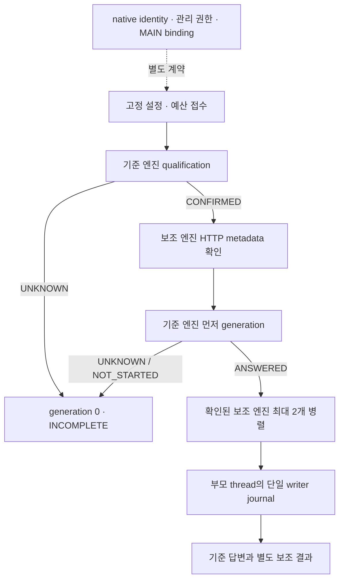

# Cellivane 기준 엔진과 보조 엔진 브릿지 실험

내용 검토: 2026-10-09. 이 문서는 `hosted/experimental/cellivane_bridge`와
`tools/hosted/cellivane_bridge_lab.py`의 격리된 초기 프로그램을 설명한다.
구현 성숙도는 `PARTIAL`, 다중 엔진의 유용성과 답변 보강 효과는 `RESEARCH`다.
명시적인 smoke에서 두 런타임·세 인스턴스의 소형 모델 추론과 Strata 미구현 차단을
실행했다. 최종 experimental 회귀 99개와 독립 journal 재판독 4건은 `PASS`다.
smoke의 전송·수집 성공과 정답 품질은 별도로 판정하며, 실제 Strata 추론은 `NOT_RUN`이다.

제품 목적과 이름은 [제품 방향](../meta/aios_product_direction_ko.md)과
[이름 정본](../meta/product_identity_and_naming_ko.md), 공개 서빙 계약은
[서빙 정본](aios_serving_design_ko.md), 장기 실행 그래프와 상태 교환은
[다중 엔진 설계](cellivane_engine_orchestration_ko.md)가 소유한다.
이 실험은 native Kernel Room 관리 권한이나 공개 MAIN/Task admission을 추가하지 않는다.
[전역 작업흐름](../meta/minimal_io_and_maturity_workflow_ko.md)의 portable 설치·기본 운용과
심핵 장기 목표를 대체하지 않는다.

<a id="bridge-current"></a>

2026-10-12 후속 [Cellivane Seed](cellivane_seed_engine_ko.md)는 작은 모델용 자체 scheduler·완료 cache·동일 요청 합류를 개발한다(`SUPPORTING`/`PARTIAL`).
기존 `kind="openai"`와 Seed reference+Ollama candidate의 실제 호환은 한정 PASS이며 새 source·최종 검사는 Seed 정본이 소유한다. token 계산은 별도 llamafile CPU worker다.
아래 원본 bridge PASS·품질 오답·Strata 차단·source hash를 새 Seed의 proof로 승계하지 않는다.

## 1. 사용자 목표와 현재 두 프로파일

사용자가 지정한 Strata는 [Niko1221/Strata](https://github.com/Niko1221/Strata)다.
Strata를 주 기준 엔진으로 두고, 다른 엔진을 보조·비교에 사용하는 방향이다.
여기서 증강·보상은 답변을 보강하고 검토할 수 있는 구조에 대한 요구다.
가중치 학습이나 RL reward 계산을 승인하거나 구현한 것으로 해석하지 않는다.

| 프로파일 | 기준 엔진과 현재 동작 | 수락 범위 |
|---|---|---|
| `strata-reference` | `kind="strata"`가 `UNKNOWN`과 `strata-runtime-qualification-not-implemented`를 기록하고 중단 | 실제 Strata process·지원 모델 qualification이 없으므로 모든 엔진 generation 0; 사용자 목표는 미완료 |
| `subengine-smoke` | 명시적으로 선택한 llamafile 기준 엔진 + Ollama 보조 엔진; 선택 시 같은 llamafile의 두 번째 인스턴스 추가 | 두 대중적 런타임과 같은 소형 모델의 실제 추론·전송·수집을 확인하는 초기 프로그램; Strata 실행 증거가 아님 |

Python lab의 `--profile`은 필수다. smoke는 반드시 명시적으로 선택한다.
기준 엔진이 준비되지 않거나 결과가 불확실하면 대체 엔진을 기준으로 자동 승격하지 않는다.
Strata 경로는 transport가 OpenAI 형태여도 일반 `openai` 경로와 별도로 차단한다.
서비스 이름·모델 alias·HTTP 200만으로 실제 Strata 추론을 승인하지 않는다.

## 2. 현재 실행 책임과 상한

`contracts.py`는 엔진 설정, `adapters.py`는 제한된 loopback HTTP 교환,
`runtime.py`는 기준 우선 실행과 결과 수집, `storage.py`는 단일 writer 기록을 맡는다.
lab launcher는 고정한 외부 binary와 모델을 D:의 별도 저장소에서 준비하고,
자신이 만든 child process handle을 소유 Windows Job에 결속해 수명을 관리한다.
빈 loopback port를 사전 확인하고 소유 process의 기동을 관측하며 시스템 서비스를 설치하지 않는다.
다만 사전 검사와 실제 bind 사이에 race가 남는다. HTTP endpoint와 소유 PID를 직접 결속해
검증한 것은 아니므로 기존 서비스 응답을 절대로 수신하지 않는다는 보장으로 해석하지 않는다.



| 계약 | 현재 구현의 한도와 의미 |
|---|---|
| 엔진 | 2..3개, 정확히 1개 `reference`; 나머지 `candidate` 또는 `reviewer`; 이름과 loopback port 중복 거절 |
| 병렬 | 보조 worker 제출 수 1..2; 기준 generation은 먼저 끝남; 전체 프로세스의 global admission 정책을 뜻하지 않음 |
| 요청 횟수 | 엔진별 generation 최대 1회, turn의 call budget은 엔진 수; 자동 retry·fallback 없음 |
| 시간 | turn deadline 1..180초, 엔진 timeout 0.1..120초; 남은 turn 시간으로 줄이고 한 probe의 여러 HTTP 교환이 같은 deadline을 공유 |
| 출력 토큰 | 엔진 설정 `max_tokens` 1..512; smoke 설정은 128; 실제 종료 형식도 별도 검사 |
| 입력 | CLI prompt UTF-8 최대 8192 bytes; adapter messages 1..32개, `system/user/assistant`의 plain role/content, 직렬화 UTF-8 최대 16KiB |
| 응답 | raw body 최대 256KiB; JSON 중복 key·비유한 숫자·과도한 깊이/노드 거절; 완료된 text/stop subset만 `ANSWERED` |
| 주소 | plain HTTP의 literal `127.0.0.1`과 명시적 port; 임의 host·credential·query·fragment·redirect/proxy 사용 없음 |
| Ollama | `stream=false`, `think=false`, `options.num_predict` 명시; model 일치·완료 상태·통계 형식 검사 |
| OpenAI 형태 | `stream=false`, 고정 token budget, 단일 choice/assistant text/finish stop 검사; 특정 backend 종류의 실제성을 보증하지 않음 |

Ollama/OpenAI 형태의 `CONFIRMED`는 `http-model-availability-only`다. 실제 서비스 process와
model artifact의 결속은 lab provenance 및 실행 증거로 별도 확인한다. 응답의 모델 이름도
실제 가중치의 신원을 혼자 증명하지 못한다. timeout과 cancel은 소유 HTTP 교환을 중단하고
turn 출력 허용을 제한하지만 backend의 request 취소·모델 unload·KV 해제를 증명하지 않는다.
deadline은 HTTP와 dispatch의 시간 예산이며 OS의 실시간 종료 보장은 아니다.

기준 결과가 `ANSWERED`이면 기준 text만 최종 `answer` 후보가 되고, 보조 결과는 별도 보존한다.
현재 `reviewer`도 같은 원문 messages를 받는 역할 표기다. 앞선 답변을 입력으로 받아 자동
비평하거나 점수로 교체하는 동작은 없다. 동일 가중치의 서로 다른 런타임을 비교하는 시험은
모델 다양성·정확도 향상·상호 독립된 추론을 입증하지 않는다.

## 3. Strata 지원 범위와 실제 엔진 판별의 한계

공식 자료 확인일은 2026-10-09다. 조사한 release는
[v0.1.41](https://github.com/Niko1221/Strata/releases/tag/v0.1.41), 소스 pin은
`fb58e0dbc8399662c0e47c76578c6e878b14f6cf`다. 아래 내용은 해당 소스의 지원 설명이며
이 PC에서 Strata를 설치·실행하거나 모델을 내려받아 확인한 결과가 아니다.

| 공식 근거 | 확인한 사실 | 이번 판단 |
|---|---|---|
| [README](https://github.com/Niko1221/Strata/blob/fb58e0dbc8399662c0e47c76578c6e878b14f6cf/README.md), [INSTALL](https://github.com/Niko1221/Strata/blob/fb58e0dbc8399662c0e47c76578c6e878b14f6cf/docs/INSTALL.md) | Windows 10/11 지원과 Windows CUDA 13/CUDA 12/HIP release가 있다. README는 12GB GPU 기준을 제시하고 INSTALL은 12GB 권장·8GB 느린 실행을 적는다 | 로컬 8GB GPU만으로 실행 불가능이라 단정하지 않는다. release 존재는 이 PC의 driver·모델 qualification이 아님 |
| [지원 모델](https://github.com/Niko1221/Strata/blob/fb58e0dbc8399662c0e47c76578c6e878b14f6cf/docs/MODELS.md), [setup 모델 설정](https://github.com/Niko1221/Strata/blob/fb58e0dbc8399662c0e47c76578c6e878b14f6cf/setup.py#L201) | Qwen3.8-Flash-Next 계열용 pack/config이며 Coder IQ1_M도 다운로드 약 58.4GB, RAM 기준 32GB다 | 작은 dense Qwen3-0.6B를 지원하는 일반 GGUF 런타임으로 취급하지 않는다 |
| [architecture 판정](https://github.com/Niko1221/Strata/blob/fb58e0dbc8399662c0e47c76578c6e878b14f6cf/tools/strata_inspect.py#L31), [expert pack 검사](https://github.com/Niko1221/Strata/blob/fb58e0dbc8399662c0e47c76578c6e878b14f6cf/tools/iq_pack.py#L434) | inspector는 고정한 `qwen4exp` architecture를 검사하고 packer는 expert tensor가 없는 모델을 거절한다 | 이번 tiny dense 모델로 실제 Strata 추론하는 경로는 미지원; 소형 Strata 시험이 미실행인 핵심 이유 |
| [device 초기화](https://github.com/Niko1221/Strata/blob/fb58e0dbc8399662c0e47c76578c6e878b14f6cf/src/core/device.cu#L249), [설치 backend](https://github.com/Niko1221/Strata/blob/fb58e0dbc8399662c0e47c76578c6e878b14f6cf/setup.py#L4667) | 실제 device/backend 초기화가 필요하고 CPU의 일부 작업 분담이 있다 | CPU 코드나 inspector 실행을 일반적인 CPU-only tiny inference 지원으로 해석하지 않는다 |
| [DETAILS](https://github.com/Niko1221/Strata/blob/fb58e0dbc8399662c0e47c76578c6e878b14f6cf/docs/DETAILS.md) | 선택적 draft/MTP와 OpenAI 형태 HTTP API를 설명한다 | draft만 실행하는 작은 모델 경로 또는 다른 런타임으로 Strata를 대체하는 허가가 아님; 이 브릿지의 token MTP는 미구현 |

Strata 서버는 기본 mock 경로를 가질 수 있다. 고정 소스의
[`/health`](https://github.com/Niko1221/Strata/blob/fb58e0dbc8399662c0e47c76578c6e878b14f6cf/serve/server.py#L4531)와
[`/v1/models`](https://github.com/Niko1221/Strata/blob/fb58e0dbc8399662c0e47c76578c6e878b14f6cf/serve/server.py#L4549)는
service/model/loaded 같은 서버 상태를 반환하지만 명시적인 real-engine attestation이나
검증 가능한 소유 PID 결속이 없다. `/api/status`는 해당 route가 없고 `/v1/status`가 있다.
[`/v1/status` 구현](https://github.com/Niko1221/Strata/blob/fb58e0dbc8399662c0e47c76578c6e878b14f6cf/serve/server.py#L3108)의
`engine`은 내부 version 등의 자체 보고다. 실제 엔진의 내부 READY 처리도 외부 HTTP 응답만으로
확인되지 않는다. 따라서 현재 `kind="strata"`는 HTTP probe를 성공으로 승격하지 않고
항상 `UNKNOWN`으로 끝낸다. 추후 소유 process·release binary·지원 model pack·real engine
readiness·실제 token generation을 결속하는 별도 qualification을 구현해야 이 차단을 풀 수 있다.

공식 inspector와 필요한 파일은 D:의 격리 연구 폴더에 고정 source로 내려받아 읽은 뒤,
로컬 GGUF 헤더만 검사했다. [inspection receipt](D:/AIOS/cellivane-bridge-20261009/research/strata-fb58e0d/inspection-receipt.json)와
[원본 로그](D:/AIOS/cellivane-bridge-20261009/research/strata-fb58e0d/tiny-model-inspection.log)는
`architecture='qwen3'`, `EXPECTED_UNSUPPORTED`, 예상대로 exit 2를 기록한다.
실제 Strata 추론은 `NOT_RUN`이고 Strata engine ZIP이나 지원 대형 가중치는 내려받지 않았다.
이는 지원 불가의 local header 검사이며 모델 inference 실패를 실행한 증거가 아니다.

Strata의 고정 [LICENSE](https://github.com/Niko1221/Strata/blob/fb58e0dbc8399662c0e47c76578c6e878b14f6cf/LICENSE)는
MIT 본문을 확인했으나 의존성·binary bundle·모델 가중치별 라이선스와 배포 호환성 검토는 별도다.
upstream 코드를 Cellivane 코드에 복사하지 않았고 기존
[source 정책](linux_hosted_substrate_and_resource_policy_ko.md)의 resource13/code_import0을 유지한다.

## 4. 고정한 소형 모델 시험과 로컬 명령

선택한 런타임은 [llamafile 0.10.5](https://github.com/mozilla-ai/llamafile/releases/tag/0.10.5)와
[Ollama v0.40.2](https://github.com/ollama/ollama/releases/tag/v0.40.2)다.
모델은 공식 [Qwen3-0.6B-GGUF](https://huggingface.co/Qwen/Qwen3-0.6B-GGUF)의
`Qwen3-0.6B-Q8_0.gguf` 한 파일을 두 런타임에 사용한다. 선택한 버전 pin이며 최신 버전 일반
지원 선언이 아니다. lab은 binary/archive/model SHA-256을 검사하고 asset provenance를 쓴다.
다른 런타임·가중치의 라이선스 전체 검토와 재배포 판단은 이 문서에서 완료로 표시하지 않는다.

lab은 D: 아래 binary·download·model·Ollama cache·소유 profile·실험 기록을 분리한다.
고정 archive의 size/SHA-256을 먼저 검사하고, cache 재사용 시 모든 regular member의 size와
hash를 원본 ZIP member와 다시 비교한다. exe/DLL도 검사 대상이며 허용한 extraction marker
외의 추가·누락 파일, symlink/reparse point, 비정규 파일은 거절한다. marker만으로 cache를
신뢰하지 않는다. 이는 이 로컬 프로그램의 고정 asset 검사이며 OS sandbox나 release 서명 검증은 아니다.
초기 CPU 시험 설정은 llamafile GPU layer 0과 Ollama GPU visibility 제한을 요청했다.
그러나 실제 `3b36f816...` 실행에서는 Ollama가 Vulkan GPU로 29/29 layers를 offload했다.
따라서 해당 결과를 두 런타임의 CPU-only 시험으로 판정하지 않는다. 이후 Vulkan을 끄고
Ollama model의 `num_gpu=0`, `num_thread=4`를 재적용한 두 별도 run에서는 CPU 배치를 로그로
확인했다. 설정 문자열과 실제 배치는 다르며 엔진 로그를 판정 근거로 삼는다.
loopback port는 18931/18932, 선택적 복제 llamafile은 18934다. 사전 확인 시 이미 사용 중인
port는 거절하지만 사전 검사 뒤 port를 차지하는 다른 process와의 race까지 닫은 것은 아니다.

다음은 작업 worktree의 루트에서 사용하는 명시적 명령이다. 모델과 llamafile의 지정 cache가
필요하고, 준비 단계는 Ollama 고정 archive를 내려받을 수 있다. 아래 명령을 문서 확인 과정에서
실행했다는 뜻은 아니다. 실행·설치·모델 사용의 실제 증거는 다음 절에 기록한다.

```powershell
# Strata 미구현 차단 확인: 모델 download/engine spawn/generation 없이 INCOMPLETE
py -3 -B tools/hosted/cellivane_bridge_lab.py --profile strata-reference --storage-root D:/AIOS/cellivane-bridge-20261009

# 명시적인 두 런타임·동일 소형 모델 시험; 실제 device 배치는 엔진 로그로 확인
py -3 -B tools/hosted/cellivane_bridge_lab.py --profile subengine-smoke --storage-root D:/AIOS/cellivane-bridge-20261009 --benchmark

# 보조 worker 두 개를 쓰는 복제 인스턴스 실험; 모델/엔진 다양성 증거가 아님
py -3 -B tools/hosted/cellivane_bridge_lab.py --profile subengine-smoke --storage-root D:/AIOS/cellivane-bridge-20261009 --parallel-smoke --benchmark
```

현재 D:에 분리한 프로그램은
`D:/AIOS/cellivane-bridge-20261009/program/bridge-0.1.0-20261009-222dcdedc759`다.
[source-manifest.json](D:/AIOS/cellivane-bridge-20261009/program/bridge-0.1.0-20261009-222dcdedc759/source-manifest.json)의
코드 10개는 최종 실행 당시 worktree와 SHA-256이 일치한다. 이는 고정한 로컬 source snapshot이며
정식 release·portable installer 완료를 뜻하지 않는다. 이후 worktree 수정이 이 사본에 자동 반영되지 않는다.

- [Run-Subengine-Smoke.cmd](D:/AIOS/cellivane-bridge-20261009/Run-Subengine-Smoke.cmd): D: 프로그램에서 명시적 smoke·세 문항·복제 reviewer를 실행한다. Strata 추론은 하지 않는다.
- [Check-Strata-Reference.cmd](D:/AIOS/cellivane-bridge-20261009/Check-Strata-Reference.cmd): Strata 기준 경로의 차단을 확인한다. 예상 exit 1·generation 0이다.

Python CLI는 `--profile`이 필수이고 PowerShell wrapper의 기본 profile은 차단되는
`strata-reference`다. smoke 실행은 명시적 선택이다. 위 CMD는 소유 엔진을 다시 기동하고 새 UUID
증거를 만드는 실행 입구이며 저장된 결과를 단순 열람하는 바로가기가 아니다.

`--benchmark`의 세 문항은 산술·고정 문자열·한국어 수도 응답의 작은 관측 시험이다.
정답 exact-match와 실행 성공은 다른 결과다. 세 문항 통과도 일반적인 답변 품질 개선이나
속도 향상 benchmark가 아니다. 기본 final answer는 끝까지 기준 엔진의 답변이다.

## 5. 기록 수명과 검증 상태

journal은 run UUID·sequence·previous SHA-256으로 사건을 연결하고 부모 thread 한 개가 쓴다.
accepted/qualification/dispatch/result/final을 별도 JSON으로 저장하며 flush·file fsync·replace를
사용한다. 저장 실패 뒤 writer는 오염 상태로 남고 성공 final을 덮어쓰지 않는다. UNC·reparse
point·비고정 Windows drive는 거절하지만 일반적인 OS sandbox나 모든 path race에 대한 보장은 아니다.
Windows의 `directory_fsync=false`를 보존하고 자동 crash replay/restart를 구현하지 않는다.
D: 쓰기 probe의 성공도 전원손실 복구·장기 내구성 proof로 승격하지 않는다.

| 범위 | 현재 판정 | 증거와 한계 |
|---|---|---|
| D: 저장소 검사 | `PASS` | [storage-probe.json](D:/AIOS/cellivane-bridge-20261009/inventory-probe-4654115c1a634e93802b161f54fda14f/storage-probe.json): 8MiB write/flush/fsync 후 close·reopen·reread SHA-256 일치, 소유 probe 파일 제거; power-loss·mmap·native storage qualification은 false |
| 최종 source의 experimental 회귀 | `PASS`: 99 tests·0 skip, 9.482초 | [experimental-regressions-final.log](D:/AIOS/cellivane-bridge-20261009/development/experimental-regressions-final.log); adapter·runtime·cache·Job lifecycle·verifier의 해당 회귀이며 전체 hosted/native 검증으로 확대하지 않음 |
| 최종 Strata 미구현 차단 | 예상대로 `INCOMPLETE`, dispatch 0 | [최종 차단 lab-summary](D:/AIOS/cellivane-bridge-20261009/lab-runs/85a50dfc-6e95-42c0-bd2a-6697249c2f86/lab-summary.json): 전용 kind UNKNOWN, process spawn 0, generation 0, answer null; [이전 차단](D:/AIOS/cellivane-bridge-20261009/lab-runs/7dc79c75-e2ef-4611-8201-6baad56fbf04/lab-summary.json)도 보존 |
| Strata 공식 inspector의 tiny GGUF 헤더 검사 | `EXPECTED_UNSUPPORTED`, exit 2 | [receipt](D:/AIOS/cellivane-bridge-20261009/research/strata-fb58e0d/inspection-receipt.json)·[로그](D:/AIOS/cellivane-bridge-20261009/research/strata-fb58e0d/tiny-model-inspection.log); 실제 Strata inference 아님 |
| 보존한 첫 llamafile + Ollama actual 추론 | 전송·수집 `PASS`: 3문항 모두 `COMPLETE`, 9개 `ANSWERED` | [actual lab-summary](D:/AIOS/cellivane-bridge-20261009/lab-runs/3b36f816-585d-440a-ae12-c249370d309f/lab-summary.json)·[asset provenance](D:/AIOS/cellivane-bridge-20261009/lab-runs/3b36f816-585d-440a-ae12-c249370d309f/asset-provenance.json); 동일 Qwen3-0.6B Q8_0, 두 runtime family·세 instance; 품질 PASS가 아님 |
| 보조 두 worker 병렬 프로파일 | actual `COMPLETE`, parallelism 2 | 같은 actual run의 `--parallel-smoke`; llamafile reviewer는 복제 인스턴스이고 새로운 모델/engine family가 아님; 공개 MAIN 병렬 admission 증거가 아님 |
| 보존한 첫 run의 device 배치 | llamafile 두 인스턴스 CPU, Ollama Vulkan GPU 포함 | [llamafile 로그](D:/AIOS/cellivane-bridge-20261009/lab-runs/3b36f816-585d-440a-ae12-c249370d309f/llamafile.log)·[reviewer 로그](D:/AIOS/cellivane-bridge-20261009/lab-runs/3b36f816-585d-440a-ae12-c249370d309f/llamafile-reviewer.log)·[Ollama 로그](D:/AIOS/cellivane-bridge-20261009/lab-runs/3b36f816-585d-440a-ae12-c249370d309f/ollama.log): Ollama NVIDIA RTX 5050 Vulkan0, 29/29 layers offloaded; 이 run은 CPU-only가 아님 |
| actual 소유 Job cleanup | 세 인스턴스 모두 `PASS` | 같은 lab-summary의 job_assigned/terminated/closed/cleanup_confirmed true, active process 0, process_exited true; backend stop API·KV release false |
| CPU 재시험 — 세 인스턴스 | 전송·수집 `PASS`, 3 `COMPLETE`·9 `ANSWERED` | [94bcd0b1 lab-summary](D:/AIOS/cellivane-bridge-20261009/lab-runs/94bcd0b1-504e-417c-9806-93965013d104/lab-summary.json)·[Ollama CPU 로그](D:/AIOS/cellivane-bridge-20261009/lab-runs/94bcd0b1-504e-417c-9806-93965013d104/ollama.log); llamafile 기준·Ollama 보조·복제 llamafile reviewer; 모두 소유 Job active0/cleanup true |
| CPU 재시험 — 두 인스턴스 | 전송·수집 `PASS`, 3 `COMPLETE`·6 `ANSWERED` | [c171f720 lab-summary](D:/AIOS/cellivane-bridge-20261009/lab-runs/c171f720-d71d-4acd-9634-eed8b3ec529d/lab-summary.json)·[Ollama CPU 로그](D:/AIOS/cellivane-bridge-20261009/lab-runs/c171f720-d71d-4acd-9634-eed8b3ec529d/ollama.log); llamafile 기준·Ollama 보조; 모두 소유 Job active0/cleanup true |
| 최종 D: 프로그램 CPU 실행 | 전송·수집 `PASS`, 3 `COMPLETE`·9 `ANSWERED` | [b259ac8d lab-summary](D:/AIOS/cellivane-bridge-20261009/lab-runs/b259ac8d-a1a0-4951-a71a-3aad0bfcd46d/lab-summary.json)·[Ollama CPU 로그](D:/AIOS/cellivane-bridge-20261009/lab-runs/b259ac8d-a1a0-4951-a71a-3aad0bfcd46d/ollama.log); 최종 코드 snapshot에서 실행, 세 인스턴스 CPU·같은 모델·동일한 품질 한계 |
| 최종 독립 journal 재판독 | 4건 `PASS`, unverifiable wire 0 | [final-audit.json](D:/AIOS/cellivane-bridge-20261009/development/final-audit.json)의 세 actual 문항과 Strata 차단 판독; evidence scope는 received journal integrity/contract, actual_backend_qualification·process_liveness_verified는 false |
| 최종 source snapshot·소유 수명 확인 | `PASS` | 같은 final audit: 코드 10개 worktree/프로그램 hash 일치; 세 Job created_suspended·assigned_before_resume·thread/process handle closed true, active0·cleanup true; 18931/18932/18934 닫힘 관측; endpoint↔PID binding은 false |
| 실제 Strata 추론 | `NOT_RUN` / 미지원 tiny 경로 | 지원 모델과 실제 process qualification 미구현; 사용자 기준 엔진 목표 미완료 |
| RL·가중치 학습 | 현재 범위 밖, 실행 `NOT_RUN` | 이번 증강·보상 요구를 RL 구현 지시로 해석하지 않음 |
| token MTP·KV 공유·native shared ring | 별도 후속 `RESEARCH`/`PLANNED`, 실행 `NOT_RUN` | 현재 브릿지의 기능이나 검증으로 기록하지 않음 |

최종 프로그램과 CPU run `b259ac8d...`, 차단 run `85a50dfc...`의 launcher SHA-256은
`222dcdedc759aaa1a75755cbdc02cbf560b66f7d3b793121362b935d27b41485`다.
최종 lab-summary의 runtime SHA 목록과 프로그램 manifest를 보존하며 final audit에서 복사본과
worktree 코드 10개가 일치함을 확인했다. 이전 run의 launcher SHA-256은 별도로 기록했다.
GPU 혼합 `3b36f816...`는
`a69f233a77fae7083a30428098f0aeb7b70432dddbe9d6be64f5159eaf497341`,
세 인스턴스 CPU `94bcd0b1...`는
`855270f7da7731b573af1bfb495e2c081b40e24dab564ca6e767042335606399`,
두 인스턴스 CPU `c171f720...`는
`b5b657622dc70806e695b5862592a324bf7fdb0ec6019265dfcc5919b04c8126`이다.
GGUF SHA-256은 `9465e63a22add5354d9bb4b99e90117043c7124007664907259bd16d043bb031`이다.
실행한 runtime family는 llamafile 0.10.5와 Ollama 0.40.2다. 최종 source의 수락 증거는
위 과거 run과 별도이며 동일 모델이라는 이유로 이전 실행의 source qualification을 재사용하지 않는다.

아래는 최종 세 인스턴스 CPU run의 공통 실제 text다. 이전 CPU run과 GPU 혼합 run도
각 문항에서 같은 text를 반환했다. 자동 보정하거나 더 좋은 답변으로 교체하지 않았다.

| 문항 | 기대한 exact text | 세 인스턴스의 공통 실제 text | 품질 판정 |
|---|---|---|---|
| 산술 | `15` | `7 + 8 = 15` | 정답 숫자는 포함하지만 숫자만 답하라는 형식 지시 불이행; exact-match 0/3 |
| 고정 문자열 | `CELLIVANE_OK` | `CELLIVANE_OK` | exact-match 3/3 |
| 한국어 수도 | `서울` | `대한민국의 수도는 **인천**입니다.` | 사실 오답이고 한 단어 지시도 불이행; exact-match 0/3 |

세 인스턴스 CPU 시험의 exact-match는 총 3/9, 두 인스턴스 CPU 시험은 2/6이며
모든 인스턴스가 같은 잘못된 수도를 답했다.
보조 엔진이나 복제 reviewer를 붙였다는 사실만으로 품질이 개선되지 않았다. lab-summary의
`outcome=PASS`는 세 요청의 실행·전송·수집·소유 Job cleanup 성공이며 답변의 정확도 PASS가 아니다.
이 결과는 현재 모델·prompt·설정의 관측 한계이고 일반적인 정확도·성능 benchmark는 아니다.

최초 [실패 lab-summary](D:/AIOS/cellivane-bridge-20261009/lab-runs/94ed414a-f19d-44b9-ad85-f6cebc0d43d6/lab-summary.json)와
[원본 llamafile 로그](D:/AIOS/cellivane-bridge-20261009/lab-runs/94ed414a-f19d-44b9-ad85-f6cebc0d43d6/llamafile.log)는
지원하지 않는 `--nobrowser` 인자로 engine이 종료한 기록을 보존한다. 해당 인자를 제거한 뒤
별도 UUID에서 재실행했으며 최초 실패를 성공으로 덮어쓰지 않았다. D: 증거는 local artifact이므로
Git commit만으로 함께 전달되는 것으로 가정하지 않는다.

loopback 응답과 journal의 무결성은 모델의 정답, management ownership 또는 backend 종료를
증명하지 않는다. 최종 Windows lab은 `CREATE_SUSPENDED`로 child를 만들고, 소유 handle을
unnamed·non-inheritable Job에 assign한 뒤에만 primary thread를 resume한다. 이 순서로 Job에
넣기 전에 child 코드가 실행해 descendant를 만드는 초기 race를 닫는다. 정상적인 descendant는
해당 Job에 포함되며 numeric PID로 다른 process를 다시 열거나 process 목록을 순회해 종료하지 않는다.
최종 actual receipt에서 created_suspended·assigned_before_resume·primary_thread_closed·
process_handle_closed를 확인했다. Job terminate·active process 0·handle close를 검사하고
확인되지 않으면 실패한다. port 사전 검사/bind race와 endpoint↔PID 미결속은 별도로 남는다.
이 process containment와 별도로
`backend_stop_api_confirmed=false`, `kv_release_confirmed=false`를 기록한다. 실제 Job 종료와
남은 port의 관측 결과가 있을 때만 cleanup PASS를 판정하며 모델별 unload/KV 해제를 추정하지 않는다.

## 6. 다음 수락 경계

Strata 기준 엔진 수락에는 지원 architecture/model pack과 binary pin, 실제 소유 process의
readiness, mock 거절, 실제 inference와 취소·불확실 결과·cleanup 증거가 필요하다.
이번 작은 dense 모델을 Strata에서 실행한 것처럼 보고하지 않는다. Strata 지원 범위 밖 모델을
임의 proxy나 alias로 가리는 대신 미지원 상태를 사용자에게 보인다.

공개 CLI/RPC 선택과 canonical MAIN/Task 연결, managed 서버 수명, 일반 DAG/재시도·자동 대체,
이기종 모델 간 실제 검토·품질 개선, shared memory/KV/가중치 공유와 native ABI 확장은
각각 별도 후속이다. 공개 daemon의 active 1 정책을 이 실험의 병렬 thread 수와 혼합하지 않는다.
브릿지의 초기 관측 결과를 장기 Kernel Room 관리 모델의 직접 완료 또는 portable 배포 완료로
승격하지 않는다.
