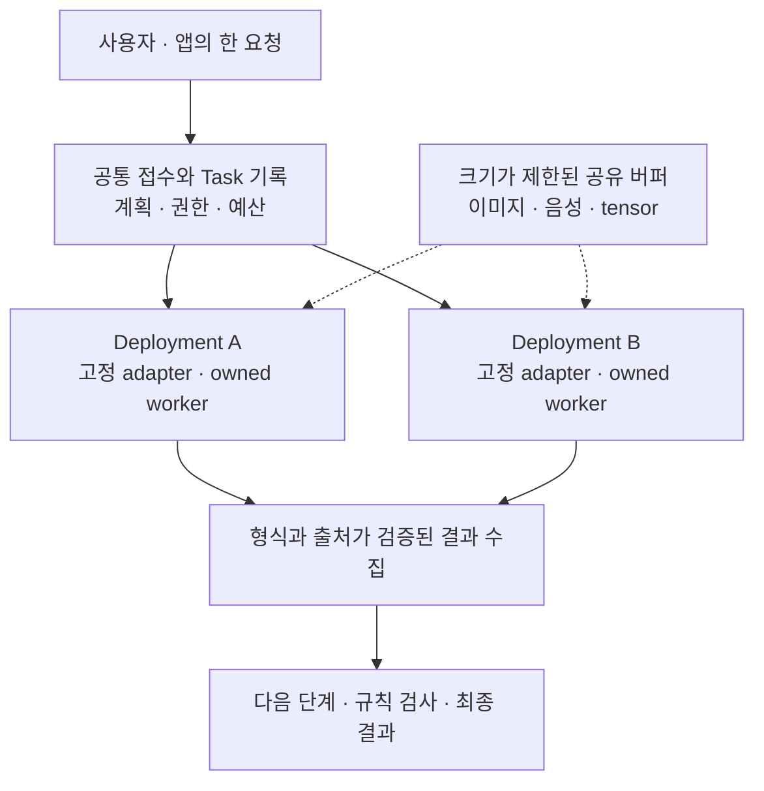

# Cellivane 다중 엔진과 상태 교환 설계

내용 검토: 2026-10-09. 문서 역할은 다중·병렬·다층 실행의 책임과 후속 수락 조건이다.
제품 표기는 [이름 정본](../meta/product_identity_and_naming_ko.md), 현재 실행 계약과
검증 결과는 [서빙 정본](aios_serving_design_ko.md), 실제 선택 순서는
[전역 작업흐름](../meta/minimal_io_and_maturity_workflow_ko.md)이 소유한다.

아래 실행 그래프·공유 버퍼·병렬 admission은 `PLANNED`다. SERVE-P1a의 명시적인
attached Ollama 내부 진입은 이 전체 설계의 첫 조각이다. 공개 CLI/RPC의 엔진 선택,
두 실제 서버, 병렬 추론, native shared-ring consumer가 구현됐다는 뜻은 아니다.

## 1. 네 가지 요구를 독립된 책임으로 표현

| 요구 | 책임 | 구분해야 할 기능 |
|---|---|---|
| 다중 | deployment별 모델·서비스·인스턴스·세대와 지원 capability를 명시 | 엔진 수와 모델 종류, 복제본 수는 서로 다르다 |
| 병렬 | 의존성이 없는 leaf 요청을 자원 예산 안에서 함께 실행하고 결과를 모음 | 모델 하나의 tensor/pipeline parallel은 backend 내부 topology다 |
| 다층 | 앞 단계의 검증된 결과를 다음 단계의 명시적 입력으로 전달 | 의미상 단계와 transformer layer를 같은 계약으로 표현하지 않는다 |
| 단순화 | 한 부모 Task의 접수·조회·취소·결과를 공통 입구로 제공 | 엔진별 wire 형식과 process 소유권은 각 adapter/deployment에 남는다 |

실행 계획은 처음에 단일 요청, 고정된 두 단계의 순차 연결, 최대 두 갈래의 병렬
분기로 제한한다. 이는 미래의 초기 수락 profile이며 현재 ABI 숫자·상한을 바꾸지 않는다.
자동 엔진 대체나 재시도는 명시적인 별도 계약이 마련되기 전에는 넣지 않는다.

이 구조는 엔진들의 결과를 연결하는 설계다. 모델 출력의 정확도 향상이나 처리 속도
향상은 동일 환경·workload의 별도 실험으로 확인해야 한다. 모델 결과는 관리 권한,
principal, canonical binding이나 실행 효과를 증명하는 자료를 자동으로 만들지 않는다.

## 2. 공유 상태와 모델 내부 상태

공통으로 교환할 첫 대상은 typed event, 텍스트 결과, 읽기 전용 상태 snapshot과
artifact reference다. 데이터에는 request·deployment·instance·generation·sequence,
형식, 길이와 유효 기간을 결속한다. 공통 결과 수집기가 Task 기록을 쓰고, 각 worker는
자신에게 배정된 출력 채널만 쓴다. 공유 mapping 이름이나 PID를
`Room -> Cell -> Node -> NodeBit` identity 대신 사용하지 않는다.

제어 경로는 pipe/socket으로 요청·취소·오류·handle을 전달한다. 큰 데이터의 복사가
실제 병목으로 확인된 구간에만 공유 버퍼를 추가한다. 버퍼 안의 주소 표현은
process pointer가 아니라 region 식별자·offset·length다. schema, dtype/shape/layout,
세대, publication 순서, reader의 사용 종료와 반환 시점을 검사한다.

최신 상태는 이전 snapshot을 대체할 수 있지만, 실행·저장·취소 사건에는 중복 처리와
ack 규칙이 필요하다. 알림 한 번이 record 한 개라는 가정도 하지 않는다. 재시작하면
이전 generation의 미완료 결과를 폐기하고 새 handshake로 연결한다. RAM buffer와
durable Task receipt는 별도 수명과 증거다.

CPU 공유메모리, GPU IPC, 가중치 공유와 KV cache 재사용은 별도 기능이다. 서로 다른
모델의 KV를 공유하려면 artifact·tokenization·architecture·dtype·cache layout과
실행 backend의 호환 조건을 별도로 증명해야 한다. 공통 prompt나 공유 region은
그 호환성을 증명하지 않는다.

## 3. 온라인 사례에서 채택한 원칙

확인일은 2026-10-09다. 공개 문서·소스를 읽은 범위이며 게임 설치·실행·성능 측정은
하지 않았다. 움직이는 main/latest URL의 내용 검토이며 immutable pin이나 code import
승인이 아니다. upstream 구현을 복사하지 않고 책임 분리 원칙만 참고한다.

| 공식 자료 | 확인한 내용 | Cellivane 적용 판단 |
|---|---|---|
| [SkyCraft](https://github.com/chasmlol/SkyCraft) | SKSE/Fabric이 두 게임의 지형·플레이어·전투를 공유메모리로 연결 | 각 엔진의 역할을 유지하고 공통 표현으로 상태를 변환 |
| [Minecraft crossover bridge](https://github.com/justbustin/minecraft-crossover-bridge/blob/main/docs/how-it-works.md) | 상태/피해 교환과 frame compositing을 분리하고 두 프로그램이 같은 파일을 map | 의미 변환, 전송 수단, 렌더링·효과를 다른 책임으로 둠 |
| [Minecraft-X-Games](https://github.com/Keel62155/Minecraft-X-Games) | 여러 host game이 같은 Minecraft를 동시에 제어하면 충돌한다고 명시 | 채널과 writer를 인스턴스별로 분리; 다중 연결 자체를 병렬 소유권 proof로 해석하지 않음 |
| [Triton ensemble](https://docs.nvidia.com/deeplearning/triton-inference-server/user-guide/docs/user_guide/ensemble_models.html) | 모델 간 입출력 dataflow를 외부에서 단일 모델로 제공; 단계 backlog를 제한 가능 | 공통 입구와 제한된 단계 그래프; backpressure·취소·timeout은 별도로 정의 |
| [Triton shared memory](https://docs.nvidia.com/deeplearning/triton-inference-server/user-guide/docs/protocol/extension_shared_memory.html) | 등록한 region·offset·byte size로 입력/출력 tensor 전달 | 전체 heap 또는 모델 내부 상태를 공유하는 것으로 확대하지 않음 |
| [Windows MapViewOfFile](https://learn.microsoft.com/en-us/windows/win32/api/memoryapi/nf-memoryapi-mapviewoffile) | 서로 다른 주소에 map할 수 있으므로 pointer 대신 offset 사용 | 프로세스 독립 descriptor와 크기·수명 검증 |
| [vLLM KV 호환 조건](https://docs.vllm.ai/en/stable/features/nixl_connector_compatibility/) | version·model 구조·dtype·attention/cache layout 등의 전송 조건 | KV 재사용을 일반적인 이기종 모델 협업과 분리 |

## 4. 수락 순서와 부정 사례

1. SERVE-P1a: attached Ollama의 명시적 내부 선택·비스트리밍 chat·고정 worker·
   unbound Task를 로컬 HTTP fixture와 독립 판독으로 검증한다. 실제 서버/모델 qualification은
   별도이며 공개 MAIN의 기존 관리 binding이나 backend stop 권한을 합성하지 않는다.
2. 실제 두 deployment의 순차 실행과 공개 선택 입구: 버전/모델을 고정한 llama.cpp와
   Ollama의 actual-model 증거, 새 public schema·source inventory·consumer를 함께 닫는다.
3. 고정 두 단계: 부모/하위 Task 계약을 추가하고, 동시에 실행하는 leaf는 처음에는 1개로
   유지한다. 다음 단계는 앞 단계의 terminal receipt가 검증된 뒤에만 접수한다.
4. 병렬 두 갈래: global leaf 2·deployment별 1 같은 별도 profile을 검증한다. 현재
   active 1 정책의 의미 변경이므로 event·Task 예산, 취소, 완료와 verifier를 함께 바꾼다.
5. 공유 버퍼: 측정된 큰 데이터 복사 구간부터 적용하고 CPU와 GPU 경로를 각각 검증한다.

새 그래프는 전체/단계별 deadline, 단계 수·깊이·fanout, queue 수/bytes, 중간 결과
bytes·token 한도, 동시 leaf를 접수 전에 예약해야 한다. 부족하면 worker 제출 없이
거절한다. 부모와 자식의 예산을 별도 ledger로 중복 계산하거나 숨겨서는 안 된다.

필수 부정 사례는 순환·과도한 깊이·예산 초과의 zero-submit, 한 branch 실패 뒤 다른
유효 결과 보존, cancel 저장 실패의 no-signal, 재시작 generation의 늦은 결과 거절,
사용 중인 buffer의 조기 재사용 거절, mutable input의 검증/사용 사이 변경, 그리고
관측·Task 결과와 process/backend 종료 증거의 분리다.

## 5. 현재 native 경계

`kernel/include/runtime/ai_ring.h`에는 ABI와 submit/completion layout이 있지만,
`kernel/runtime/ai_syscall.c`의 notify는 통계를 기록하고 wait는 `AIOS_ERR_NOSYS`다.
장기 userspace consumer와 실제 SQ consume/CQ produce의 구현·실행 증거는 없다.
[native runtime 정본](../../os/runtime/README.md)을 따른다. Hosted fixture·브리지·
단계 그래프를 독자 native 커널의 zero-copy inference 완료로 기록하지 않는다.
